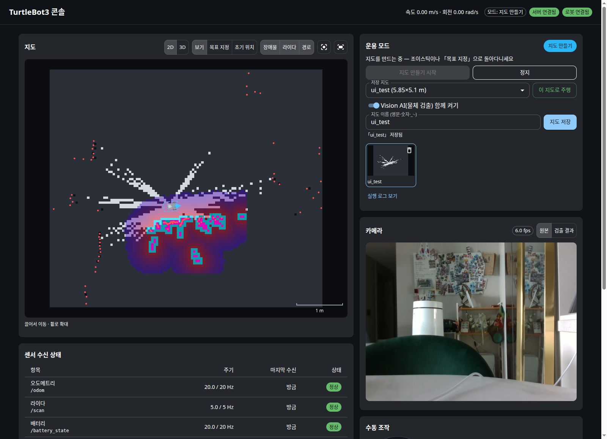
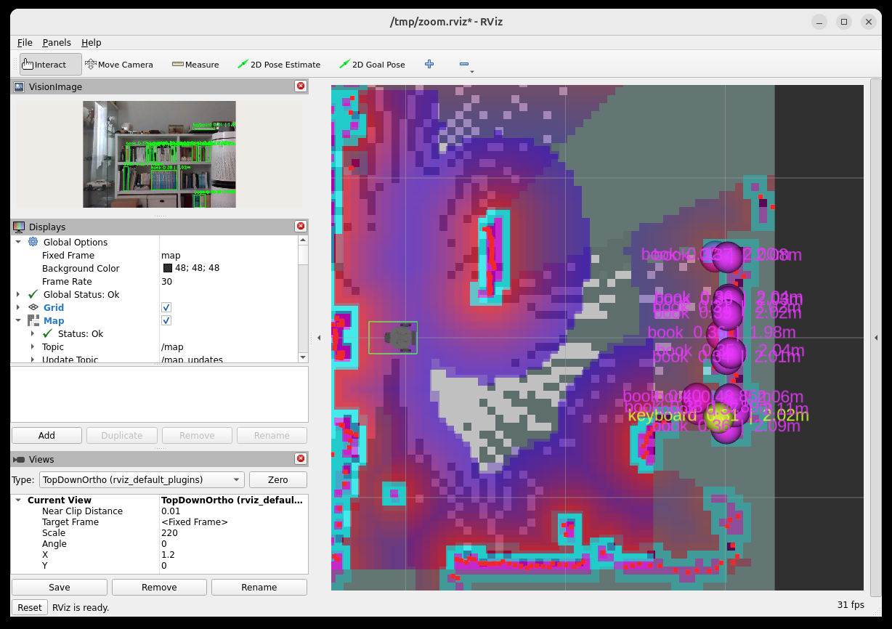

# turtlebot3-slam-nav-vision

ROBOTIS **TurtleBot3 실물 로봇**으로 **SLAM · Navigation · Vision AI**를 구현하는
개인 포트폴리오 프로젝트입니다. 최종 지향점은 로봇청소기처럼 **돌아다니며 지도를
만들면서 동시에 주행하고, 카메라로 주변을 인식하는 자율주행 로봇**입니다.

표준 데모를 그대로 쓰는 게 아니라, **표준과 형태가 다른 커스텀 로봇**에 맞춰
실제 문제(센서 TF 보정, 원격 네트워크 통신 등)를 해결한 과정을 보여주는 것이
핵심입니다.

## 시스템 아키텍처

물리적으로 떨어진 두 머신을 Tailscale(VPN)로 연결하고 역할을 분리합니다.

```
[Raspberry Pi @ TurtleBot3]              [Remote PC / 서버]
  - turtlebot3_bringup (센서 publish)      - Docker (ROS 2 Humble 컨테이너)
  - RealSense D435i (compressed 전송)      - SLAM / Nav2 / Vision AI (개발 대상)
  - zenoh-bridge (systemd)                - zenoh-bridge (컨테이너)
  - Tailscale                             - Tailscale, NVIDIA GPU
        └──────── Tailscale (Zenoh Bridge, tcp/7447) ────────┘
```

- **Pi** = 센서 publish 전용 엣지 (bringup 은 수정하지 않음)
- **Remote PC** = 무거운 연산 전부 (Docker 컨테이너 안에서 개발)

자세한 아키텍처·네트워크·기술 스택은 [CLAUDE.md](./CLAUDE.md)를 참고하세요.

## 기술 스택

| 영역 | 선택 |
|------|------|
| ROS 2 | Humble (Ubuntu 22.04) |
| 실행 환경 | Docker (`osrf/ros:humble-desktop` 기반) |
| SLAM | slam_toolbox (online async) |
| Navigation | Nav2 |
| 원격 통신 | **Zenoh Bridge** (zenoh-bridge-ros2dds) — Fast DDS 의 VPN 한계 진단 후 전환 |
| 카메라 | RealSense D435i — **자체 pyrealsense2 노드** (공식 노드의 Pi4 USB 불안정을 캘리브레이션 캐시·프로세스 분리로 우회), 컬러 + 컬러 정렬 depth compressed 원격 전송 |
| Vision AI | **RF-DETR** + **TensorRT**(fp16, 컨테이너 안에서 엔진 빌드·캐시) + 정렬 depth 거리 → 3D 위치 |
| 센서 융합 | TurtleBot3 기본 오도메트리(바퀴 거리 + **IMU 회전각**, `use_imu: true`). robot_localization(EKF)은 실주행 검증 후 필요 시 |
| 시각화 | RViz2 (개발자용) · **웹 콘솔** (운용자용 — FastAPI + rclpy 백엔드 API, React + TypeScript + MUI, 2D 지도 react-konva · 3D three.js, 실물 CAD 로봇 모델, 카메라 MJPEG) |

## 레포 구조

```
turtlebot3-slam-nav-vision/
├── docs/                      # 컴포넌트별 상세 문서 + 트러블슈팅 로그
├── docker/                    # Remote PC 컨테이너 (Dockerfile, entrypoint)
├── docker-compose.yml         # zenoh-bridge + remote-pc + web-api 서비스
├── secrets/                   # (git 제외) 웹 → Pi 전원 버튼용 SSH 키
├── config/                    # zenoh 브리지 설정 등 공용 설정
├── remote_pc/src/             # Remote PC 패키지 (my_slam, my_navigation, my_vision, my_bringup 통합런치, my_web_api 웹 백엔드)
├── web/                       # 웹 콘솔 프론트엔드 (React + TypeScript + Vite)
├── robot/src/                 # Raspberry Pi 패키지 (realsense_bringup)
├── robot/systemd/             # Pi 사용자 서비스: bringup, 부팅 시 대기, 라이다·전원 감시
├── robot/tools/               # Pi 보조 스크립트 (scan_watchdog: /scan 정지·전원 저하 기록, 정지 복구)
└── description/               # my_description 패키지: 보정 URDF + 실물 CAD 메시 (RViz 표시용)
```

## 개발한 내용

각 컴포넌트의 "정상 동작 원리"는 `docs/` 에 초심자도 이해할 수준으로 정리돼 있습니다.

| 컴포넌트 | 내용 | 상태 | 문서 |
|---|---|---|---|
| **my_slam** | slam_toolbox 기반 2D SLAM. 로봇 라이다(`/scan`)로 지도 작성 + 위치추정 | ✅ 실물 검증 | [docs/my_slam.md](./docs/my_slam.md) |
| **my_navigation** | Nav2 자율주행. 지도 만들며 주행(기본) / 저장 지도+AMCL 모드. **실측 footprint**(전장 28cm 직사각형) 반영 | ✅ 실기 검증 (실주행 튜닝 예정) | [docs/my_navigation.md](./docs/my_navigation.md) |
| **description** | 커스텀 로봇 URDF 센서 TF 실측 보정 (LDS 위치, IMU 회전·위치, **RealSense 카메라 프레임 체인**) + **실물 CAD 메시**로 RViz 로봇 모델 교체 | ✅ Pi 배포·TF 실기 검증 (전 항목 실측 완료), CAD 메시 RViz 확인 | [docs/description.md](./docs/description.md) |
| **realsense_bringup** | D435i 브링업 — **자체 pyrealsense2 노드**: 컬러 + 컬러에 정렬된 depth(PNG 16bit, mm) compressed publish. 공식 노드가 Pi4 에서 간헐 실패하는 문제를 캘리브레이션 캐시·프로세스 분리 감시·온화한 복구로 해결 | ✅ 원격 수신 검증 (기본 6fps, 15fps 까지 확인) | [docs/realsense_bringup.md](./docs/realsense_bringup.md) |
| **인프라/네트워크** | Tailscale + **Zenoh Bridge** (Fast DDS Discovery Server 의 VPN 한계를 진단 후 전환) | ✅ 검증 완료 | [docs/troubleshooting.md](./docs/troubleshooting.md) |
| **my_bringup** | 통합 런치 — SLAM/AMCL + Nav2 + Vision(map 좌표 마커) + RViz 한 창 (`system.launch.py`, `system.rviz`) | ✅ 실기 검증 | [docs/my_bringup.md](./docs/my_bringup.md) |
| **my_vision** | RF-DETR 물체 검출(torch/**TensorRT** 백엔드) + 정렬 depth 로 거리·3D 위치 → **TF2 로 base_link/map 좌표 변환**(`/vision/objects`), RViz 마커, 주석 영상, 카메라 뷰어 | ✅ 실물 검증 (TensorRT 6ms) | [docs/my_vision.md](./docs/my_vision.md) |
| **카메라 기반 회피** | 라이다(125mm 평면)가 못 보는 장애물 보완 — ① depth 점 구름 → Nav2 장애물 지도, ② **Vision AI 의미 층**: 검출 물체 종류별 회피 여유·사람 근처 감속 (자체 Nav2 costmap 플러그인) | 🔧 ① 구현 (V1, 바닥 검증 대기) · ② 설계 | [docs/vision_avoidance_design.md](./docs/vision_avoidance_design.md) |
| **web UI** | 터미널·RViz 대신 브라우저로 운용 — FastAPI + rclpy 백엔드 API(모드 관리: 지도 만들기/주행 전환, Nav2 목표, 카메라 MJPEG) + React 프론트엔드, Pi·서버 자동 실행 | 🚧 P0 자동 실행·P1 상태/카메라·P2 지도/클릭 주행·P3 모드 관리/지도 저장/조이스틱·전원 버튼(대기·켜기·재부팅·끄기) 구현 ✅ (실주행 검증 대기, 다음 P4) | [docs/my_web_api.md](./docs/my_web_api.md) · [설계](./docs/web_ui_design.md) |

## 시작하기

> 최초 환경 구축(새 머신)은 [docs/pi_setup.md](./docs/pi_setup.md)(로봇) ·
> [docs/server_setup.md](./docs/server_setup.md)(서버) 참고.
> 아래는 구축이 끝난 상태에서의 **일상 실행 절차** — Pi 와 웹 콘솔은 자동으로 뜨고, SLAM/Nav2 는 아직 서버 터미널 1개에서 실행한다.

### 1. 로봇(Pi) — 전원만 켜면 된다

배터리를 연결하면 Pi 와 zenoh-bridge 가 켜지고 로봇은 **대기 상태**(라이다·카메라 정지)로 기다린다.
**웹 콘솔 상단의 「켜기」** 로 로봇 기본(모터·오도메트리·라이다·TF) + RealSense 카메라를 시작한다 — 대기·ROS 재시작·
Pi 재부팅·끄기도 같은 전원 버튼에서 (systemd 사용자 서비스 `tb3-bringup` + `robot-standby` — 설치는
[docs/pi_setup.md](./docs/pi_setup.md) 9단계). 터미널로 확인·조작할 때는 sudo 없이:

```bash
ssh michael@100.71.74.81                         # 맥에서 (SSH 키 등록돼 있으면 비밀번호 없음)
systemctl --user status tb3-bringup              # 상태
journalctl --user -u tb3-bringup -f              # 로그 (Ctrl+C 는 로그 보기만 끝냄)
systemctl --user restart tb3-bringup             # 재시작 (stop / start 도 같은 형식)
```
- 정상 로그: `[자식] pipeline.start() 성공` → `스트리밍 시작` → 10초마다 `6.0 fps | color … | depth …`
  (콜드 스타트는 장치 열거에 ~11초 걸리는 게 정상)
- launch 인자 변경(예: 15fps): `~/.config/tb3-bringup.env` 에 `TB3_LAUNCH_ARGS=fps:=15` → restart

직접 실행이 필요할 때(디버깅) — **먼저 서비스를 멈출 것** (같이 뜨면 OpenCR·카메라를 다툰다):
```bash
systemctl --user stop tb3-bringup
ros2 launch realsense_bringup full_bringup.launch.py   # 카메라 제외 camera:=false / 공식 드라이버 camera_driver:=realsense2
ros2 launch turtlebot3_bringup robot.launch.py         # 또는 개별: 로봇 기본
ros2 launch realsense_bringup rs_camera.launch.py      #          카메라 (자체 노드, 기본 640x480@6fps)
```

> ⚠️ 시작 중인(아직 fps 로그가 안 찍힌) 카메라 프로세스를 `kill -9` 하지 말 것 — 카메라가 USB 버스에서
> 떨어져 물리 재연결이 필요해진다 ([docs/realsense_bringup.md](./docs/realsense_bringup.md) 7장).

### 2. 웹 콘솔 — 브라우저만 열면 된다

서버가 켜져 있으면 `web-api` 컨테이너가 자동으로 떠 있다. 맥·폰(Tailscale 접속 상태)에서:

```
http://100.95.193.1:8080        운용 모드·지도(2D/3D, 라이다·카메라 depth 점)·클릭 주행·금지 구역(거울·유리)·조이스틱·카메라·배터리·센서 상태
http://100.95.193.1:8080/docs   API 문서
```



**터미널 없이 지도 만들기부터 주행까지:**
1. 「운용 모드」 →「지도 만들기 시작」 (SLAM + Nav2 + Vision 이 뜬다, 약 10초)
2. **조이스틱**(누르고 있는 동안만 움직임, 손 떼면 정지) 또는 지도의 「목표 지정」으로 돌아다니며 지도를 그린다
3. 이름을 정해 「지도 저장」 → 목록에 미리보기와 함께 나타남
4. 저장 지도를 고르고 「이 지도로 주행」 → 지도의 「초기 위치」로 로봇 위치를 알려 준다
5. 「목표 지정」→ 목표 위치를 누르고 바라볼 방향으로 끌었다 놓기 →「이동」(확인을 한 번 더 받는다). 「정지」로 대기 모드

- 로봇은 URDF 의 실물 CAD 로 그린다. 「2D / 3D」 로 전환하면 RViz 처럼 돌려 볼 수 있다 (3D 는 보기 전용).
- 서버 터미널에서 SLAM/Nav2 를 직접 띄워 둔 상태면 웹은 시작을 거절한다 (두 벌 실행 방지) — 아래 3번은 개발·디버깅용.
화면 코드를 고쳤으면 서버에서 `cd web && npm run build` ([docs/my_web_api.md](./docs/my_web_api.md) 5장).

### 3. 서버 터미널에서 직접 실행 (개발·디버깅 — SLAM + Nav2 + Vision + RViz 한 창)

```bash
docker compose up -d                 # 컨테이너가 내려가 있을 때만 (zenoh-bridge + remote-pc)
docker compose exec remote-pc bash   # 컨테이너 진입 (ROS·워크스페이스 자동 source)

export DISPLAY=:0                    # RViz 를 서버 물리 세션에 띄움 (VNC 로 봄; 번호는 who 로 확인)
ros2 launch my_bringup system.launch.py
```
이 한 줄로 **slam_toolbox + Nav2 + Vision(TensorRT, 검출 물체를 map 좌표 마커로) + RViz** 가 뜬다.
RViz 툴바의 **2D Goal Pose** 로 목표를 찍으면 주행하고, 카메라가 검출한 물체는 지도 위 마커로 보인다
([docs/my_bringup.md](./docs/my_bringup.md)).



자주 쓰는 변형:
```bash
ros2 launch my_bringup system.launch.py use_slam:=false map:=/overlay_ws/maps/my_map.yaml   # 저장 지도 + AMCL
ros2 launch my_bringup system.launch.py threshold:=0.3            # 검출 더 민감하게 (backend:=torch 로 비교 가능)
ros2 launch my_bringup system.launch.py vision:=false             # SLAM + Nav2 만
ros2 run nav2_map_server map_saver_cli -f /overlay_ws/maps/my_map # 지도 저장 (SLAM 모드, 다른 터미널에서)
```
Vision 설정(모델·가중치 경로·임계값·백엔드·TensorRT 옵션)은 `remote_pc/src/my_vision/config/vision_params.yaml`
한 곳에서 바꾼다. 전이학습 모델은 YAML 의 `weights` 에 .pth 경로 (클래스 수 자동 추론, 엔진 캐시 자동 분리).

### 4. 확인·디버깅 (서버, 다른 터미널에서 `docker compose exec remote-pc bash`)

```bash
ros2 topic hz /scan                          # 로봇 연결 (~5Hz)
ros2 topic hz /camera/color/compressed       # 카메라 (~6fps). ★ 12Hz 처럼 정수배면 브리지 중복 → 아래 주의 2
ros2 topic echo /vision/objects              # 검출 물체: 클래스·점수 + map(또는 base_link) 좌표 3D 위치
export DISPLAY=:0
ros2 run my_vision camera_viewer                                              # 카메라 원본: color | 정렬 depth | 오버레이
ros2 run my_vision camera_viewer --color-topic /vision/annotated/compressed   # 검출 박스가 그려진 영상 (q 로 종료)
ros2 run my_vision camera_viewer --snapshot /tmp/cam.jpg                      # 창 없이 한 장 저장
ros2 run tf2_ros tf2_echo base_link camera_color_optical_frame               # 카메라 TF (0.058, 0.033, 0.060)
```
개별 컴포넌트만 띄우려면 `ros2 launch my_slam slam.launch.py` / `my_navigation navigation.launch.py` /
`my_vision vision.launch.py` (각 docs 참고).

### 5. 순서·주의

1. **Pi 먼저(bringup+카메라) → 서버(system.launch)** 가 자연스럽지만, 반대여도 붙는다.
2. **서버 브리지를 재시작·재생성했다면 Pi 브리지도 같이** — Pi 에서 `kill $(pgrep -f "zenoh-bridge-ros2dd[s]")`
   (systemd 가 3초 뒤 자동 재시작, sudo 불필요). 안 하면 토픽이 2배로 중복 수신되어 검출이 멈출 수 있다
   ([docs/troubleshooting.md](./docs/troubleshooting.md) 2026-09-08).
3. "토픽은 보이는데 데이터 0" 이면 브리지 재시작: 서버 `docker compose restart zenoh-bridge` + 위 2번.
4. Pi 전원은 배터리 분기 → UBEC 5V/5A → GPIO 로 보강돼 있다 (OpenCR 5V 로 되돌리면 카메라 부하에서
   CPU 가 600MHz 로 스로틀돼 fps 가 떨어짐 — `vcgencmd get_throttled` 의 bit0). UBEC 는 OpenCR 스위치를
   거치지 않으므로 **사용 후 배터리를 뽑을 것** ([docs/troubleshooting.md](./docs/troubleshooting.md) 2026-11-05).
5. 새 패키지/파일이 추가된 커밋을 받았을 때만 재빌드: 서버 `cd /overlay_ws && colcon build --symlink-install`,
   Pi `cd ~/realsense_ros_ws && colcon build --packages-select realsense_bringup --symlink-install`.
   `docker-compose.yml` 이 바뀐 커밋(마운트·env 변경)은 `docker compose up -d` 로 컨테이너를 재생성해야 반영된다.
6. `description/urdf` 가 바뀐 커밋은 Pi 에서 URDF 를 다시 복사하고 bringup 재실행
   ([docs/pi_setup.md](./docs/pi_setup.md) 8단계). 메시 파일은 Pi 에 필요 없다.

### 참고

- Pi↔서버 통신은 zenoh-bridge 가 담당하며, 브리징되는 토픽은
  `config/zenoh-bridge-server.json5` / `robot/config/zenoh-bridge-pi.json5` 의
  allow 리스트로 관리합니다 (카메라는 compressed 만 — raw 는 대역폭 초과).
- 카메라 토픽: `/camera/color/compressed`(JPEG) · `/camera/depth/compressed`(컬러 정렬
  depth, PNG 16bit mm) · `/camera/color/camera_info`, 셋 다 같은 stamp, best effort QoS.
- 상세 개발 문서: [docs/](./docs/) · 프로젝트 전체 컨텍스트: [CLAUDE.md](./CLAUDE.md)
