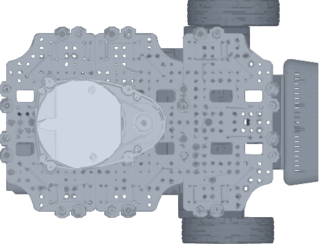
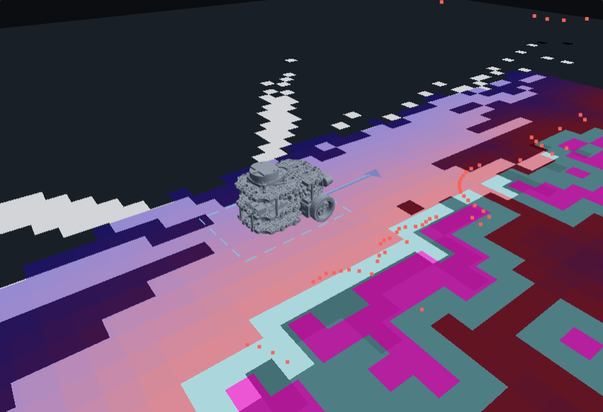
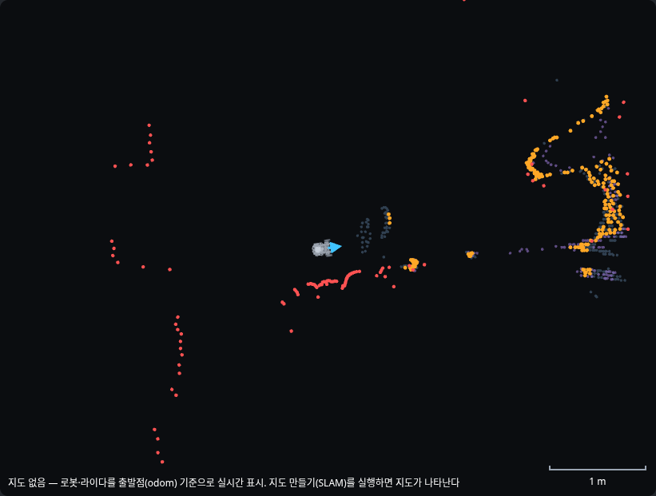
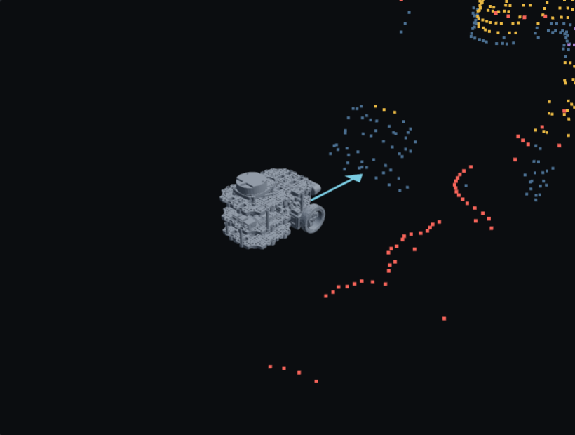
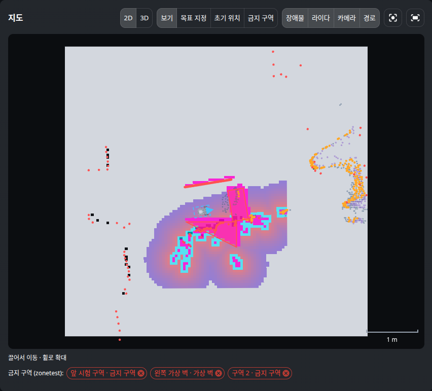

# my_web_api + web — 브라우저로 보는 로봇 콘솔

> 설계와 단계 계획은 [web_ui_design.md](./web_ui_design.md). 이 문서는 **구현된 것의 동작 원리**를 설명한다.
> 현재 범위: **P1 — 연결 상태 · 배터리 · 센서 수신 상태 · 카메라 영상** (2026-11-10),
> **P2 — 지도 위 로봇·라이다·로컬 장애물 지도·경로, 클릭으로 Nav2 목표·취소·AMCL 초기 위치** (2026-11-12),
> **P3 — 웹 버튼으로 지도 만들기·저장·저장 지도로 주행 전환, 조이스틱 수동 조작** (2026-11-12).


(P1 화면: [web_ui_p1.png](./images/web_ui_p1.png))

## 1. 한 줄 요약

서버의 `web-api` 컨테이너가 **ROS 토픽을 받아 사람이 읽기 쉬운 API 로 바꿔** 주고, 같은 주소에서 React 화면을
제공한다. 브라우저는 `http://<서버 Tailscale IP>:8080` 만 열면 되고, **ROS 를 전혀 모른다.**

```
[Pi] bringup·카메라 ──Zenoh──▶ [서버] web-api 컨테이너 ───────────────▶ [브라우저]
                                  ├ rclpy 노드: /odom /scan /battery_state     GET  /               React 화면
                                  │   /camera/*/compressed /vision/*            GET  /api/status     상태 JSON
                                  │   /map /local_costmap/* /plan /local_plan   GET  /api/camera.mjpg 영상
                                  │   TF(map→로봇), Nav2 NavigateToPose 액션     GET  /api/map.png    지도
                                  └ FastAPI: 좌표 변환·PNG·MJPEG·WebSocket      POST /api/nav/goal   주행 목표
                                                                                 WS   /ws             실시간 push
```

## 2. 코드 구조

```
remote_pc/src/my_web_api/            ROS 2 패키지 (ament_python)
├── config/web_api.yaml              포트·배터리 판정 전압·토픽 이름 (단일 소스)
├── launch/web_api.launch.py         compose 의 web-api 가 실행
├── my_web_api/
│   ├── monitor.py                   ROS 없는 순수 로직: 토픽 주기 계산, 최신 프레임 보관, 배터리 판정
│   ├── geometry.py                  ROS 없는 2D 변환: 쿼터니언↔yaw, 점 변환, 라이다 극좌표→점, 솎기
│   ├── zones.py                     ROS 없는 금지 구역 로직: 검증·저장·지도 좌표 다각형 → Keepout 마스크 격자
│   ├── robot_power.py               로봇 전원(대기·켜기·재시작·재부팅·끄기) — Pi 에 전용 SSH 키로 robot_power.sh 호출
│   ├── depth_points.py              카메라 depth → 지도 좌표 3D 점 (my_vision depth_cloud 의 역투영 재사용, 3D 회전, 5cm 솎기)
│   ├── robot_model.py               URDF → base_link CAD 메시 → 위에서 본 이미지(PNG)·3D 용 STL(gzip)
│   ├── map_codec.py                 OccupancyGrid → RGBA PNG (지도 / costmap 색 규칙)
│   ├── nav.py                       Nav2 목표·취소·진행 상태, AMCL 초기 위치 (ROS 스레드 큐)
│   ├── mode_manager.py              운용 모드: system.launch 를 프로세스 그룹으로 켜고 끔, 외부 실행 감지
│   ├── maps.py                      저장 지도 목록·미리보기·저장(map_saver_cli)·삭제
│   ├── teleop.py                    조이스틱 → /cmd_vel (0.3초 워치독, 속도 상한, 시작 시 Nav2 목표 취소)
│   ├── ros_node.py                  rclpy 노드: 구독·TF → 지도 좌표로 정리, snapshot() 으로 상태 조립
│   ├── app.py                       FastAPI 라우트: 상태·영상·지도·주행 API, WebSocket, 정적 파일
│   └── server.py                    진입점: ROS 스레드 + uvicorn, 종료 순서
├── test/                            monitor·geometry·map_codec·robot_model·maps·teleop 단위 테스트 25개
└── tools/                           fake_nav.py(로봇 안 움직이는 가짜 Nav2) · nav_api_check.py(주행 API 점검)

web/                                 React 프론트엔드 (npm 프로젝트, ROS 패키지 아님)
├── vite.config.ts                   개발 서버가 /api·/ws 를 web-api(:8080)로 프록시
└── src/
    ├── api/types.ts                 서버 데이터 형식 (ros_node·app·nav 와 1:1)
    ├── api/useRobot.ts              WebSocket 하나로 모든 실시간 데이터 (reducer), 자동 재연결
    ├── api/nav.ts                   주행 요청 (TanStack Query mutation)
    ├── api/mode.ts                  모드 전환·지도 목록/저장/삭제·실행 로그
    ├── components/ModePanel.tsx     운용 모드 버튼, 지도 저장·선택·삭제(확인 대화상자), 실행 로그
    ├── components/Joystick.tsx      가상 조이스틱 (누르는 동안만 0.1초마다 전송, 속도 조절)
    ├── api/robot.ts                 로봇 모양 정보 (TanStack Query)
    ├── components/MapView.tsx       react-konva 2D 지도: 레이어·확대/이동·따라가기·목표 찍기·로봇 CAD 윗모습
    ├── components/Map3D.tsx         react-three-fiber 3D 화면 (보기 전용, 「3D」 누를 때만 내려받음)
    ├── components/MapPanel.tsx      도구(보기·목표·초기 위치)·레이어 토글·목표 확인 창
    ├── components/NavPanel.tsx      주행 상태·남은 거리·취소
    ├── components/StatusBar.tsx     모드·서버 연결·로봇 연결·속도
    ├── components/CameraPanel.tsx   MJPEG , 원본/검출 결과 전환
    ├── components/BatteryCard.tsx   전압·셀 전압·판정
    └── components/TopicTable.tsx    토픽별 주기·마지막 수신·상태
```

## 3. 사용 기술과 선택 이유

| 기술 | 역할 | 왜 |
|---|---|---|
| **FastAPI** + uvicorn | HTTP·WebSocket 서버 | rclpy 와 같은 파이썬. 비동기·WebSocket 기본 지원. `/docs` 에 API 문서 자동 생성 |
| **rclpy** | 토픽 구독 | 이미 my_vision 이 쓰는 공식 클라이언트. P2 에서 Nav2 액션·TF2 를 그대로 쓴다 |
| **React 19 + TypeScript + Vite 8** | 화면 | 로봇 웹 UI 레퍼런스(rmf-web, Foxglove 패널)가 React. 타입으로 API 형식 불일치를 컴파일 때 잡는다 |
| **MUI 9** | 화면 부품 | 카드·표·칩·토글 같은 대시보드 부품이 다 있어 직접 CSS 를 거의 안 씀 |
| **MJPEG** | 카메라 영상 | 아래 4.3 |
| **react-konva** (Konva 10) | 지도 그리기 | 캔버스 위에 레이어(이미지·점·선·다각형)를 React 컴포넌트로 쌓고, 확대·이동·포인터 좌표 변환을 기본 제공. ros2djs 계열은 roslibjs 전제·유지보수 불분명 |
| **three.js + react-three-fiber + drei** | 3D 화면 | 브라우저 3D 표준(WebGL). React 컴포넌트로 장면을 쌓고 STL 로더·궤도 카메라를 기본 제공. Foxglove 도 브라우저에서 같은 방식으로 URDF 메시를 그린다 |
| **TanStack Query** | 주행 요청 | 목표·취소 POST 의 진행 중·오류 상태를 선언적으로 (P1 엔 REST 호출이 없어 P2 에서 도입) |
| **OpenCV**(서버) | PNG 인코딩 | 컨테이너에 이미 있음. 격자 → PNG 를 버전당 한 번만 |

## 4. 원리

### 4.1 두 세계를 잇는 스레드 구조

ROS(rclpy)는 콜백을 **자기 스레드**에서 부르고, FastAPI 는 **asyncio 이벤트 루프**에서 돈다. 둘을 한 프로세스에 둔다.

```
메인 스레드:  uvicorn (asyncio) ── 요청이 오면 node.snapshot() / FrameStore.get() 을 읽는다
백그라운드:   rclpy executor ──── 메시지가 오면 TopicMonitor.record() / FrameStore.put() 으로 쓴다
                                    ↑ 둘 사이의 공유 데이터는 전부 threading.Lock 으로 보호 (monitor.py)
```

콜백은 "받았다는 기록"과 "최신값 저장"만 하고 계산은 하지 않는다. 주기(Hz)·경과 시간·판정은 화면이 물어볼 때
(`snapshot()`, 0.5초마다) 계산한다 → 20Hz 토픽이 많아도 ROS 쪽 부담이 거의 없다.

### 4.2 토픽 주기 계산

최근 3초 동안 받은 메시지 시각들로 `(개수 − 1) / (마지막 − 처음)` 을 계산한다. 2초 넘게 안 오면 "수신 없음"
(Vision 처럼 선택 토픽은 "꺼짐"). 기대 주기의 70% 미만이면 화면에 "느림" 으로 표시 — 예: Pi 전원 저하로
카메라가 3fps 로 떨어지면 바로 보인다.

**마지막 수신 시각은 주기 계산과 따로 보관한다.** 끊긴 뒤에도 "언제 마지막으로 받았는지"(3분 12초 전, 마우스를 올리면
실제 시각)를 보여주기 위해서다. 처음 구현은 3초 창 안의 시각 목록에서 마지막 값을 꺼내 써서, 끊기고 3초가 지나면
마지막 수신 시각까지 사라져 "—" 로만 보였다 (2026-11-12 사용자 발견 → 수정). 한 번도 받지 못한 토픽은 "기록 없음".

### 4.3 카메라 영상: MJPEG

로봇은 이미 영상을 **JPEG 로 압축**해서 보낸다(`/camera/color/compressed`). MJPEG(Motion JPEG)는 HTTP 응답 하나에
JPEG 를 경계 문자열로 이어 붙여 계속 보내는 방식이고, 브라우저 `` 가 이를 동영상처럼
갱신한다. 그래서 **서버도 브라우저도 디코딩·재인코딩을 하지 않는다** — 받은 JPEG 바이트를 그대로 흘린다.
WebRTC 는 지연·대역폭에 유리하지만 6fps·0.2MB/s 영상에는 복잡도만 늘어난다.

서버는 새 프레임이 있을 때만(버전 번호 비교) 보내고, 화면은 토픽 상태가 "정상"일 때만 `` 를 띄운다
(영상이 없을 땐 이유를 글로 표시).

### 4.4 QoS

`/scan`·카메라는 publisher 가 **best effort** 라 reliable 로 구독하면 아무것도 못 받는다(my_slam.md 의 QoS 설명).
best effort 구독은 reliable publisher(`/odom` 등)도 받을 수 있으므로 전부 센서 QoS(`qos_profile_sensor_data`)로 통일했다.

### 4.5 배터리: % 보다 셀 전압

`/battery_state.percentage` 는 Pi 가 아니라 **OpenCR 펌웨어가 계산한 값**이다. 실측 3점(12.00V→83.3%,
12.22V→95.5%, 12.35V→102.8%)이 **10.5V=0%, 12.3V=100% 직선**과 정확히 일치한다. 그래서 충전 중엔 100% 를 넘고,
LiPo 의 실제 방전 곡선(중간에 오래 머물다 끝에서 급락)과도 다르다. 화면은 이 값을 0~100 으로 잘라 **참고용**으로만
보여주고, 판정은 **셀당 전압**으로 한다: 3.5V(3S 10.5V) 미만 "충전 권장", 3.3V(9.9V) 미만 "즉시 중단"
(`config/web_api.yaml`).

### 4.6 종료 순서 (끝나지 않는 응답이 있을 때)

MJPEG·WebSocket 은 브라우저가 닫을 때까지 끝나지 않는 연결이라, 종료를 잘못 다루면 서버가 멈추거나 강제 종료된다.
`server.py` 는 신호를 **직접** 받아 이렇게 끝낸다.

1. SIGINT/SIGTERM → `stop` 이벤트 set (열린 MJPEG·WebSocket 루프가 스스로 끝남) + uvicorn 에 종료 요청
2. uvicorn 이 남은 연결을 최대 2초 기다린 뒤 닫고 `server.run()` 이 정상 반환
3. ROS executor 정지 → 노드 파괴 → `rclpy.shutdown()`

이렇게 된 과정(uvicorn 의 신호 재발생, 중복 SIGINT)은 [troubleshooting.md](./troubleshooting.md) 2026-11-10 항목.

### 4.7 지도 화면의 좌표 — 서버가 전부 map 좌표로 바꿔서 보낸다

ROS 에서 데이터마다 좌표계가 다르다. 브라우저가 이걸 다루지 않도록 **서버가 TF 로 전부 지도(map) 좌표, 미터로
바꿔서** 보낸다 (`ros_node.py`, `geometry.py`).

| 데이터 | 원래 좌표계 | 서버에서 하는 일 |
|---|---|---|
| 로봇 위치 | `base_footprint` | TF `map → base_footprint` 조회 (WebSocket 이 0.1초마다) |
| 라이다 `/scan` | `base_scan` (극좌표: 각도·거리) | (각도, 거리) → (x, y) 로 바꾸고 360 빔을 180 개로 솎은 뒤 `map ← base_scan` 변환 |
| 로컬 장애물 지도 | `odom` (로봇을 따라다니는 3m 창) | 격자 원점(x, y, 회전)을 `map ← odom` 으로 변환해 메타에 실음. 이미지는 그대로 |
| 전역 경로 `/plan` | `map` | 300 점 이하로 솎기만 |
| 단기 궤적 `/local_plan` | `odom` | 솎고 `map ← odom` 변환 |
| 로봇 외곽 | `odom` (`/local_costmap/published_footprint`) | 변환. footprint 값 자체는 nav2_params.yaml 이 단일 소스 (웹에 복제하지 않음) |

**표시 좌표계 자동 전환.** SLAM·AMCL 이 꺼져 있으면 `map` 좌표계 자체가 없다. 이때는 `odom`(로봇이 켜진 위치 기준)으로
바꿔서 로봇과 라이다를 계속 실시간으로 보여주고, 지난 지도는 숨긴다 (화면에 "출발점(odom) 기준" 표시). 좌표계가 아예
없으면 라이다는 빈 목록을 보내 옛 점을 지운다. 처음 구현에선 `map` 이 없으면 라이다를 안 보내서 **화면에 SLAM 을 끈
시점의 점과 지도가 멈춘 채 남아 "라이다가 실시간이 아닌" 것처럼 보였다** (2026-11-12 사용자 발견 → 수정). 「초기 위치」
도구에선 AMCL 이 아직 위치를 모르므로 지도를 보여주고 odom 기준 레이어를 숨긴다.

**오래된 레이어 숨기기.** Nav2 가 꺼지면 로컬 장애물 지도·footprint 는 더 이상 오지 않는데, 처음엔 마지막 값이 그대로
남아 로봇이 움직여도 옛 자리에 그려졌다 (2026-11-12 3D 화면 확인 중 발견). 상태에 `costmap_age`·`footprint_age` 를
실어 보내고, 화면은 3초 넘게 갱신이 없으면 숨긴다 (publish 주기 2Hz·5Hz). 지도는 저장 지도 모드에서 한 번만 오므로
age 로 숨기지 않고 표시 좌표계로 판단한다.

TF 는 **메시지 시각이 아니라 최신 값**으로 조회한다. Pi→서버 브리지 지연 때문에 메시지 시각에 정확히 맞추면
"extrapolation" 오류가 잦고, 화면 표시에선 수십 ms 차이가 보이지 않는다. 변환식은 2D 회전 + 평행이동
(`p_map = R(yaw)·p + t`) 이고, 쿼터니언은 지면 로봇이라 yaw 만 쓴다.

### 4.8 격자 지도 → 이미지

`OccupancyGrid` 는 칸마다 값이 하나인 2차원 배열이다. 서버가 색을 입혀 PNG 로 만들고(`map_codec.py`), 브라우저는
지도 좌표의 원점에 깔기만 한다.

- 지도: -1 미지(어두운 회색) · 0 빈 공간(밝은 회색) · 100 장애물(검정).
- 로컬 장애물 지도: 자유 공간은 투명, 장애물 주변 비용(inflation)은 파랑→빨강, 로봇이 닿는 거리(inscribed)는
  하늘색, 장애물(lethal)은 자홍색 — RViz 의 costmap 색과 같게 해서 개발자가 둘을 오가도 헷갈리지 않게 했다.
- 격자의 0번 행은 **지도 아래쪽**인데 이미지의 0번 행은 위쪽이라, 서버에서 위아래를 뒤집어 보낸다.
- 지도는 slam_toolbox 가 5초마다 새로 보낸다. 서버는 받은 것마다 버전을 올리고, 브라우저는 `?v=버전` 주소로
  요청하므로 같은 버전은 캐시된다. PNG 인코딩도 버전당 한 번.

### 4.9 브라우저에서 그리기 (react-konva)

화면 좌표는 아래로 y 가 커지고, 지도 좌표는 위로 y 가 커진다. `MapView.tsx` 는 이렇게 처리한다.

```
Stage (화면):   위치 (x, y) + 배율 s [픽셀/미터]   ← 확대·이동은 이 세 값만 바꾼다
 └ world 그룹:  scaleY = -1  (y 를 뒤집어 '지도 좌표계'를 만든다)
     └ 모든 레이어를 지도 좌표(미터) 그대로 그린다: 지도 이미지, 장애물 지도, 라이다 점, 경로, 로봇
```

- 선 굵기·점 크기는 확대해도 같은 픽셀로 보이게 `strokeScaleEnabled={false}`, 점 반지름 = 픽셀 / s.
- 격자 이미지는 원점에 회전 그룹을 두고 그 안에 `scaleY=-1` 로 다시 뒤집어 깐다 (서버가 뒤집은 것을 되돌림).
- 포인터 위치는 world 그룹의 `getRelativePointerPosition()` 이 곧 지도 좌표다 → 목표 좌표 계산 코드가 없다.
- "로봇 따라가기" 는 상태로 저장하지 않고 그릴 때마다 로봇 위치로 Stage 위치를 계산한다.

### 4.10 목표 지정과 안전 장치

- **누른 곳 = 목표 위치, 끌어서 놓은 방향 = 도착 후 바라볼 방향** (RViz "2D Goal Pose" 와 같은 조작).
  끌지 않고 탭만 하면 로봇에서 그 점을 바라보는 방향.
- 찍은 즉시 보내지 않고 **확인 창 → 「이동」** 을 한 번 더 눌러야 전송된다. 폰에서 지도를 만지다 실수로 로봇이
  출발하는 것을 막는다. 같은 방식으로 「초기 위치」(AMCL `/initialpose`)도 지정한다.
- 「목표 지정」은 Nav2 액션 서버가 있을 때만 켜지고, 주행 중엔 큰 「주행 취소」 버튼이 활성화된다.

### 4.11 Nav2 액션을 웹에서 부르는 법 (스레드 규칙)

목표 전송은 Nav2 의 `NavigateToPose` **액션**이다 (요청 → 수락/거절 → 진행 feedback → 결과). rclpy 객체를
FastAPI 스레드와 ROS 스레드가 동시에 만지지 않도록 `nav.py` 는 이렇게 한다.

```
POST /api/nav/goal ─▶ 큐에 (요청, Future) 넣기 ─▶ ROS 타이머(20Hz)가 꺼내 send_goal_async
                         ◀─ Future 결과(수락/거절/Nav2 없음) ◀─ 수락 응답 콜백
feedback·결과 콜백 ─▶ 상태(state·남은 거리·경과·복구 횟수) 갱신 + 버전 ↑ ─▶ WebSocket 'nav' 로 push
```

실패는 HTTP 코드로 구분한다: Nav2 미실행 503, 거절·진행 중 목표 없음 409, 응답 없음 504. 목표를 연달아 보내면
이전 목표의 늦은 콜백이 새 상태를 덮어쓰지 않도록 목표 번호(seq)를 비교한다.

### 4.12 로봇 모양 — URDF 의 CAD 메시를 그대로

지도 위 로봇은 화살표가 아니라 **실물 CAD** 로 그린다 (RViz 의 RobotModel 과 같은 모양).



- **URDF 가 단일 소스**: Pi 가 보내는 `/robot_description` 에서 base_link 의 visual 메시 경로(`package://…`)·scale·
  origin 과 `base_footprint→base_link` 조인트 오프셋을 읽는다 (`robot_model.py`). CAD 를 바꿔 URDF 를 갱신하면 웹도
  따라온다 — 웹 쪽에 치수·파일명을 따로 적지 않는다.
- **2D: 위에서 본 이미지를 서버가 한 번 그린다**: STL(10만 삼각형)을 위에서 투영해 낮은 면부터 칠하고 높은 면이 덮는
  화가 알고리즘으로 PNG(0.5mm/픽셀, 462×354)를 만든다. 색은 높이(바닥 어둡게 → 위 밝게)가 주, 면 방향 음영은 약하게.
  이미지 좌표 = base_footprint 좌표라서 웹은 로봇 위치에 놓고 yaw 만큼 돌리기만 한다. 수백 ms 걸리므로 ROS 콜백을
  막지 않게 별도 스레드에서. 지도 칸은 또렷하게(보간 끔), 로봇 그림은 부드럽게(보간 켬) 보이도록 별도 Konva 레이어.
- **3D: 같은 STL 을 gzip 으로** 보낸다 (`GET /api/robot/mesh.stl`, 5MB → 1.9MB). 서버 전체에 gzip 을 켜면 끝나지 않는
  MJPEG 스트림까지 압축하려다 망가지므로, 미리 압축해 둔 메시 응답에만 `Content-Encoding: gzip` 을 붙인다.
  주소에 `?v=<URDF·메시 해시>` 를 붙여 같은 모델은 브라우저 캐시를 쓴다. 3만 삼각형 경량본(gzip 0.57MB)도 시험했지만
  구멍 뚫린 플레이트가 구겨져 보여 원본을 택했다.
- Nav2 가 켜져 있으면 실측 footprint 를 점선으로 겹쳐 그린다 — 로봇 뒤 여백은 카메라 USB 케이블 돌출분(정상).

### 4.13 3D 화면



「2D / 3D」 전환. 3D 는 **보기 전용**이다 (목표 찍기는 2D 가 정확하고 편해서 2D 에만).

- **좌표**: ROS 와 같은 z-up (`Object3D.DEFAULT_UP = (0,0,1)`), 지도 좌표(미터) 그대로 — 서버 데이터를 변환 없이 쓴다.
- **레이어 높이**: 지도 z=0, 로컬 장애물 지도 z=4mm(겹침 깜빡임 방지), 라이다 점은 실제 라이다 높이 z=0.135
  (URDF: base_link 10mm + scan_joint 125mm), 경로 z=1cm. 로봇은 STL → URDF visual 변환 → 로봇 pose.
- **텍스처**: 지도 PNG 는 위쪽 = +y 이고 three 평면의 텍스처 위쪽(v=1)도 +y 라 그대로 맞는다. 지도는 5초마다 새로
  오므로, 새 이미지를 다 받은 뒤 바꿔 끼우고 이전 텍스처는 GPU 메모리에서 해제한다.
- **조작**: 왼쪽 끌기 회전, 오른쪽 끌기 이동, 휠 확대 (OrbitControls). 「로봇 따라가기」는 카메라와 회전 중심을 로봇이
  움직인 만큼 같이 옮겨 보는 각도를 유지한다. 바닥 아래로 돌아가지 않게 각도 제한.
- **가볍게**: three.js(~950KB)는 「3D」 를 누를 때만 내려받고(React.lazy → 별도 파일), 데이터가 바뀌거나 조작할 때만
  다시 그린다(`frameloop="demand"`) — 폰 배터리·발열.

### 4.14 운용 모드 — 웹이 launch 를 켜고 끈다

| 모드 | 웹 버튼 | 실행되는 것 |
|---|---|---|
| 대기 | 「정지」 | 없음 (web-api 만). 라이다·카메라·조이스틱은 그대로 쓸 수 있다 |
| 지도 만들기 | 「지도 만들기 시작」 | `system.launch.py use_slam:=true rviz:=false` → slam_toolbox + Nav2 (+ Vision) |
| 주행 | 저장 지도 고르고 「이 지도로 주행」 | `system.launch.py use_slam:=false map:=<지도>.yaml` → map_server + AMCL + Nav2 (+ Vision) |

- **프로세스 그룹으로 띄우고 그룹째 끈다** (`mode_manager.py`): `start_new_session=True` 로 새 그룹을 만들고, 끌 땐 그룹
  전체에 SIGINT → 20초 안에 안 끝나면 SIGTERM → SIGKILL. 백그라운드 launch 가 SIGINT 를 못 받던 함정
  (troubleshooting 2026-11-05)을 피하는 같은 원리. web-api 가 종료될 때도 띄운 launch 를 이렇게 정리한다.
- **준비 판정**: Nav2 액션 서버가 뜨고, 시작 뒤에 지도가 들어오면 "실행 중". 그 전엔 "시작 중"(진행 막대).
  지도 만들기는 약 7초, TensorRT 엔진이 캐시에 있으면 Vision 도 수 초 안에 뜬다.
- **전환 중엔 다른 요청 거절**(409), 모드를 바꾸기 전에 진행 중인 Nav2 목표를 먼저 취소한다.
- **외부 실행 감지**: 서버 터미널에서 이미 SLAM·Nav2 를 띄워 두었으면(ROS 그래프에 slam_toolbox·bt_navigator 등이
  보이는데 웹이 띄운 게 아님) 시작을 거절하고 화면에 경고 — 두 벌이 뜨면 TF·지도가 꼬인다. 웹이 직접 끈 노드도
  그래프 목록에서 사라지기까지 몇 초 걸려서, 끈 직후 15초는 남은 이름을 외부 실행으로 보지 않는다 (처음 구현에서
  "정지 → 바로 시작" 이 외부 실행으로 오판됐다).
- **Vision 도 같이** 띄우므로 web-api 컨테이너에 GPU 를 준다 (compose `deploy`). 종료 유예 45초.
- **실행 로그**: launch 출력을 파일로 받아 꼬리 60줄을 `GET /api/mode/log` 로 — 화면 「실행 로그 보기」, 오류 시 자동 표시.
- 주행 모드는 시작 후 「초기 위치」 로 AMCL 에 로봇 위치를 알려 줘야 지도 기준 위치가 생긴다 (그 전엔 odom 기준 표시).

### 4.15 지도 저장·관리

- 저장은 nav2 `map_saver_cli` 를 그대로 부른다 (README·my_slam.md 의 수동 절차와 같은 도구·같은 결과 파일 yaml+pgm).
  폴더는 `/overlay_ws/maps` (호스트 `remote_pc/maps`, git 제외 — 사용자 데이터).
- 이름은 영문·숫자·_·- 1~40자만 (경로 조작 `../` 방지). 기본값은 `map_YYYYMMDD_HHMM`.
- 목록은 미리보기(pgm → 웹 지도와 같은 색 PNG)와 크기(m)를 보여주고, 삭제는 확인 대화상자를 거친다.
  지금 주행에 쓰는 지도는 지울 수 없다(409).

### 4.16 조이스틱 — 안전 장치가 서버에 있다

```
브라우저: 누르고 있는 동안 0.1초마다 {"type":"teleop", x, y, scale}  ─WS─▶  서버 teleop.py
          손 뗌 / 탭 전환 / 창 포커스 잃음 → {"type":"teleop_release"}           │
서버 ROS 타이머(10Hz): 마지막 명령이 0.3초 이내면 → /cmd_vel (Twist)  ◀──────────┘
                       아니면 → 정지(0,0) 3번 보내고 조용히 (계속 0 을 보내면 Nav2 명령과 싸움)
WebSocket 이 끊기면 → 즉시 정지
```

- 브라우저를 믿지 않는다: 속도 상한(전진 0.15 m/s · 회전 1.0 rad/s, `web_api.yaml`)·작은 떨림 무시(데드존)는 서버가 한다.
  화면의 속도 조절(20~100%)은 그 상한에 곱해진다.
- 조이스틱을 움직이기 시작하면 진행 중인 Nav2 목표를 취소한다 (두 명령이 섞이지 않게).
- `/cmd_vel` 은 `geometry_msgs/Twist` — Pi 의 turtlebot3_node 구독 형식을 `ros2 topic info -v` 로 확인했다
  (bringup 설정의 `enable_stamped_cmd_vel: true` 는 이 노드에 적용되지 않음, Nav2 와도 같은 형식).

### 4.17 카메라 depth 점 — 라이다처럼 실시간으로 (2D·3D)

라이다 빨간 점 옆에 **카메라가 지금 보는 것**을 높이별 색으로 그린다. 주황 = Nav2 카메라 장애물 층이 찍는 높이(4~25cm),
옅은 파랑 = 바닥(그 앞이 비어 있음), 보라 = 로봇보다 높은 것. 「카메라」 레이어 버튼으로 켜고 끈다.

```
/camera/depth/compressed + camera_info ─▶ (4Hz 로 솎아) 역투영 ─▶ TF 3D 회전 → 표시 좌표계 ─▶ 5cm 칸마다 1점 ─▶ WS {"type":"depth_points"}
```

- **Nav2 없이도 보인다**: 웹 백엔드가 depth 를 직접 받아 계산한다. Nav2 용 `/camera/points`(my_vision `depth_cloud_node`,
  Nav2 와 함께 뜸)를 구독하지 않는 이유 — 그 노드를 항상 켜 두면 서버 터미널에서 Nav2 를 띄울 때 발행자가 둘이 된다.
  계산 함수(`PixelRays`·`depth_to_points`)는 my_vision 것을 그대로 import 하므로 Nav2 가 보는 점과 같은 계산이다.
- 라이다(2D 평면, `lookup` 의 x·y·yaw)와 달리 카메라 광학 좌표계는 축이 돌아가 있어(z 앞·y 아래) **3D 회전 행렬**로 변환한다
  (`lookup3d`). z 는 바닥 기준 높이 — 3D 화면은 그대로 쓰고, 2D 는 색 구분에만 쓴다.
- 전송량: stride 8(80×60) → 범위·높이(1m 이하) 거르기 → 5cm 칸 솎기 = 약 800점, 약 3Hz, **≈42KB/s** (실측).
  float32 를 그대로 반올림하면 JSON 에 `0.550000011920929` 처럼 길게 나가 float64 로 바꾼 뒤 반올림한다.
- 색 구분 높이는 `web_api.yaml` 의 `depth_obstacle_min/max_height` — Nav2 `camera_mark` 값과 맞춰 둘 것.

| 2D | 3D |
|---|---|
|  |  |

### 4.18 금지 구역·가상 벽 — 거울·유리 대응 (Nav2 Keepout Filter)

**왜**: 라이다(적외선 레이저)와 카메라 depth(적외선 스테레오)는 거울에서 빛이 튕겨 나가 **빈 공간으로 보거나**, 거울 속 상을
**거울 뒤에 있는 것처럼** 찍는다. 유리는 통과한다. 센서만으로는 확실히 못 막으므로, 로봇청소기 앱의 "가상 벽·금지 구역"처럼
사람이 지도에 그린다. 이 방에도 큰 거울 패널이 있다 (카메라 영상에서 확인).

```
웹: 「금지 구역」 도구 → 점 찍기 → 완료 ─PUT /api/maps/{지도}/zones─▶ maps/<지도>.zones.json
                                                                   │ (그 지도로 주행 중이면 즉시)
web-api: 지도 격자(yaml+pgm 크기·원점)에 다각형을 칠한 마스크(100 = 금지) ─▶ /keepout_filter_mask   (transient local)
         필터 정보(type=keepout, 마스크 토픽)                               ─▶ /costmap_filter_info  (transient local)
Nav2:    global·local costmap 의 KeepoutFilter 가 마스크 칸을 LETHAL 로 덮음 → 경로 계획·회피가 그곳을 지나지 않음
```

- **가상 벽**(점 2개 이상, 선, 두께 6cm) / **금지 구역**(점 3개 이상, 닫힌 영역). 지도 아래 칩으로 목록·삭제(확인 후).
- **저장 지도로 주행(NAVIGATION) 중에만 편집**: 구역은 지도 좌표라 그 지도에서만 의미가 있다. SLAM 지도는 켤 때마다 원점이
  달라 구역을 둘 수 없다. 같은 이름으로 지도를 다시 저장하면(새 지도) 옛 구역 파일은 지운다.
- **별도 노드 없이 web-api 가 마스크를 발행**: Nav2 표준 예제는 map_server 로 마스크 이미지 파일을 띄우지만, 그러면 고칠 때마다
  다시 불러와야 한다. Humble 1.1.20 KeepoutFilter 는 새 마스크가 오면 실행 중에도 바꿔 끼우므로(`maskCallback`) 웹에서
  고치면 바로 반영된다. 마스크는 map 좌표 — local costmap(odom 기준)에도 필터가 TF 로 변환해 적용한다 (소스 확인).
  대기·SLAM 중엔 1×1 빈 마스크를 보내 필터가 '마스크 없음' 경고를 내지 않게 한다.
- **주의 — 여유 폭 없음**: 필터는 inflation 층 **뒤에** 적용돼 금지 구역 둘레엔 부풀림이 붙지 않는다. 몸체는 들어가지 않지만
  경계에 붙을 수 있으므로 실제 거울보다 10cm 쯤 앞에 긋는다 (화면 안내에 표시).
- 웹 콘솔 없이 서버 터미널로 Nav2 만 띄우면 마스크 발행자가 없어 금지 구역이 적용되지 않는다 (필터는 정보를 기다리기만 함).
- 검증 (2026-11-12, 로봇 정지): 저장 지도로 주행 중 구역을 추가·삭제 → 두 costmap 로그 `New filter mask arrived`,
  local costmap 에 즉시 반영. 경로 계산(`compute_path_to_pose`)으로 금지 구역 너머 목표: 구역 없을 때 경로 점 24개가 그 영역을
  지나감(1.48m) → 구역 있을 때 0개, 돌아가는 경로(1.86m). UI 그리기·완료·삭제 흐름은 headless Chrome 으로 확인.



### 4.19 로봇 전원 — 대기·켜기·ROS 재시작·Pi 재부팅·끄기 (`robot_power.py`, `PowerControl.tsx`)

**왜**: 배터리를 연결하면 Pi 가 켜지고 예전엔 bringup 도 바로 떠서, 쓰지 않을 때도 라이다가 계속 돌며 배터리를 썼다.
이제 **부팅 시 기본은 대기**(Pi 의 `robot-standby.service`)이고, 웹 상단의 전원 칩·버튼으로 켜고 끈다.

| 동작 | Pi 에서 일어나는 일 | 다시 켜기 |
|---|---|---|
| 켜기 / 대기 | `tb3-bringup` 시작 / 정지 → 라이다 모터·카메라 스트림·모터 제어 정지 (Pi·네트워크는 유지) | 웹 「켜기」 |
| ROS 재시작 | `tb3-bringup` 재시작 (센서 끊김 복구 — by-id 포트라 USB 재연결 뒤에도 됨) | — |
| Pi 재부팅 | `systemctl reboot` → 1~2분 뒤 대기 상태로 복귀 | 자동 |
| Pi 끄기 | bringup 정지 → `systemctl poweroff` (SD 카드 보호) | **배터리 재연결** (꺼진 Pi 는 네트워크가 없다) |

- **라이다가 정말 멈추나**: LDS-01 은 시리얼로 `b` 를 받으면 회전·송신, `e` 를 받으면 정지한다. 드라이버가 종료 때 `e` 를
  보내므로 bringup 을 멈추면 모터도 멈춘다 — 실측: 정지 후 시리얼 수신 0 B, `b` 를 보내면 2초에 25 KB, `e` 로 다시 0 B.
  대기 동작과 부팅 시 대기 서비스는 확실히 하려고 `e` 를 한 번 더 보낸다.
- **왜 SSH 인가** (ROS 서비스·토픽이 아니라): 대기 중엔 Pi 의 ROS 가 꺼져 있으니 켜는 명령은 ROS 바깥으로 가야 한다.
  zenoh 브리지는 허용 목록의 토픽만 넘기고, 목록 변경은 Pi 시스템 서비스 재시작(sudo)이 든다.
  그래서 web-api 가 **전용 키**로 Pi 에 SSH 하고, Pi `authorized_keys` 의 `restrict,command="…/robot_power.sh"` 가
  어떤 명령을 보내든 그 스크립트만 실행시킨다 (요청은 `SSH_ORIGINAL_COMMAND` 로 받아 6개 동작만 허용, 셸·포워딩 불가).
  재부팅·끄기는 Pi `sudoers.d/robot-power` 에 그 두 명령만 비밀번호 없이 허용. 키는 레포 `secrets/`(git 제외)에 두고
  compose 가 `/secrets` 로 읽기 전용 마운트, Pi 호스트 키는 고정(`StrictHostKeyChecking=yes`).
- **상태**: 5초마다(전환 중 1.5초) Pi 에 `status` 를 물어 bringup 상태(systemd)·uptime·throttled 를 받고, 로봇 데이터(odom)
  수신 여부와 합쳐 `running / starting / standby / stopping / rebooting / off / unreachable / error` 로 보여 준다
  (`/api/status`·WebSocket status 의 `power`). 재부팅은 "uptime 이 요청 시각 이후"가 될 때까지 '재부팅 중'.
- **안전**: 대기·재시작·재부팅·끄기 전에 조이스틱 해제·주행 목표 취소, 웹에서 띄운 SLAM·Nav2 를 IDLE 로 끄고 끝날 때까지
  기다린다 (센서 없이 Nav2 가 돌거나 지도 만들기가 망가지지 않게). 모든 동작은 확인 창을 거치고, 지도 작업 중이면 경고를 띄운다.
- 대기·꺼짐처럼 일부러 끈 상태에선 '로봇 응답 없음' 경고 칩을 숨긴다.
- 검증 (2026-11-12, 실기): 대기 → 3초 'stopping' → 6초 'standby', Pi 에 ROS 노드 없음·LDS 시리얼 0 B/2s.
  켜기 → 'starting' → 15초 뒤 로봇 데이터 수신 'running'. Pi 재부팅 → 'rebooting' → **54초 뒤 'standby'**
  (robot-standby 정상 종료, LDS 0 B, bringup 꺼짐, zenoh-bridge·scan-watchdog 실행, throttled 0x0).
- 설치 함정: 레포 파일 링크로 enable 된 사용자 서비스는 `systemctl --user disable` 이 **링크까지 지운다** → 'Unit not found'
  로 웹 「켜기」 가 실패. `systemctl --user link …/tb3-bringup.service` 로 다시 등록 (pi_setup 9-2 ①).

## 5. 실행

### 평소 (서버 부팅 시 자동)

compose 의 `web-api` 서비스가 `restart: unless-stopped` 로 떠 있다. 브라우저에서:

```
http://100.95.193.1:8080        웹 콘솔 (맥·폰 모두 Tailscale 접속 상태에서)
http://100.95.193.1:8080/docs   API 문서 (FastAPI 자동 생성)
```

```bash
docker compose logs web-api -f       # 로그
docker compose restart web-api       # 설정(web_api.yaml)·백엔드 코드 변경 후
```

### 코드를 고쳤을 때

| 바꾼 것 | 할 일 |
|---|---|
| 백엔드 파이썬 (`my_web_api/*.py`) | `docker compose restart web-api` (symlink-install 이라 재빌드 불필요) |
| 새 파일·setup.py·launch | 컨테이너에서 `colcon build --symlink-install --packages-select my_web_api` → restart |
| 프론트엔드 (`web/src`) | 서버 호스트에서 `cd web && npm run build` → 브라우저 새로고침 (web-api 가 `web/dist` 를 그대로 제공) |
| 프론트엔드 개발 중 | `cd web && npm run dev` → `http://<서버>:5173` (저장하면 즉시 반영, API 는 :8080 으로 프록시) |

### 테스트

```bash
docker compose exec remote-pc bash -c 'cd /overlay_ws/src/my_web_api && python3 -m pytest -q test'   # 25 passed
cd web && npm run build && npm run lint                                                              # 타입·린트
```

**로봇을 움직이지 않고 주행 흐름 시험** — 진짜 Nav2 가 꺼진 상태에서 가짜 액션 서버를 띄운다:

```bash
docker compose exec remote-pc bash
source /opt/ros/humble/setup.bash
python3 /overlay_ws/src/my_web_api/tools/fake_nav.py &          # navigate_to_pose 흉내 (cmd_vel 없음)
python3 /overlay_ws/src/my_web_api/tools/nav_api_check.py       # 목표→도착 / 목표→취소 / 거절 / 초기 위치
```

## 6. 검증 기록

**P1 (2026-11-10, 로봇 실기)**

- `/api/status`: odom 19.7Hz, scan 4.9Hz, battery 20Hz, color·depth 6.0Hz 정상, vision "꺼짐"(미실행). 배터리 12.22V·셀 4.07V "정상".
- MJPEG 3초: 19프레임(6fps 기대치 18), 프레임당 약 48KB — 로봇 JPEG 그대로.
- WebSocket: 0.5초 간격 status 수신.
- 종료: MJPEG 연결이 열린 상태에서 SIGINT → 0.4초 내 정상 종료, traceback 없음 (2회 반복).
- compose `web-api` 기동 후 Tailscale 주소(`100.95.193.1:8080`)로 화면·`/docs` 접속 200, 데스크톱·폰 폭(400px) 레이아웃 확인.

**P2 (2026-11-12, 로봇 실기 + 시험용 가짜 Nav2)**
- 실제 SLAM+Nav2 (`system.launch.py rviz:=false vision:=false`): 지도 117×90칸(5cm), 로컬 장애물 지도 60×60칸
  (원점이 map 기준으로 변환됨), 3초 동안 WebSocket 으로 위치 23·라이다 16(≈5Hz)·장애물 지도 6(2Hz)·외곽 16 메시지.
- 경로: 로봇을 움직이지 않는 `compute_path_to_pose`(계산만) 요청 → 전역 경로 22점이 지도에 표시.
- 로봇 외곽: 실측 footprint + Nav2 기본 여유 1cm 를 로봇 방향(3.7°)만큼 돌린 값과 일치 (0.065, 0.104).
- 주행 API (가짜 Nav2): 목표→수락→feedback→도착, 목표→취소→canceled, 거절 409, 진행 중 목표 없음 409,
  Nav2 미실행 503, `/initialpose` 내용(map 프레임, yaw 0.3 → z 0.149) 확인.
- 화면 (헤드리스 크롬 원격 조작): 「목표 지정」→ 화면 오른쪽 위로 끌기 → 확인 창 "목표 (0.14, 0.78) m · 45°" →
  「취소」→ 목표 미전송(nav 버전 불변). 휠 확대·로봇 따라가기 확인.
- 지도 없는 대기 상태(SLAM·Nav2 꺼짐): odom 기준으로 라이다 4초 21메시지(0.2초 간격, 끊김 없음), 점 좌표 매 메시지 갱신.
  라이다 점은 컴포넌트 하나(Konva Shape)로 그려 5Hz 갱신 부담을 줄였다.
- 로봇 모양(2026-11-12): URDF 에서 메시를 읽어 위에서 본 이미지 462×354px 렌더, 2D 지도의 로봇 위치·방향에 표시.
  3D(헤드리스 크롬 소프트웨어 WebGL): SLAM 지도·장애물 지도·라이다·CAD 로봇·점선 footprint·앞 화살표 표시 확인,
  메시 gzip 전송 1,876,461B (원본 5,000,084B).
- ⏳ **실제 주행(목표 클릭 → 로봇 이동 → 장애물 회피가 화면에 보임)은 로봇을 바닥에 두고 사용자 입회 하 검증 예정.**

**P3 (2026-11-12, 로봇 정지 상태)**
- API: 대기 → 지도 만들기(약 7초에 실행 중, Vision TensorRT 6ms) → 지도 저장(117×104칸) → 잘못된 이름 400 →
  저장 지도로 주행 → 사용 중 지도 삭제 409 → 「초기 위치」 로 AMCL 위치 잡힘 → 대기 (SLAM·Nav2·Vision 프로세스 0).
- 외부 실행: 개발 컨테이너에서 `system.launch.py` 를 띄운 상태로 웹 시작 → 409 거절, 화면 경고 표시.
- 조이스틱: 로봇에 안 가는 `/cmd_vel_test` 로 출력하는 시험용 web-api(:8081)로 기록 — 반쯤 위·왼쪽 → 0.075 m/s·0.5 rad/s,
  손 뗌 → 0.3초 뒤 정지 3번 후 조용, 속도 50% 끝까지 위 → 0.075 m/s, 연결 끊김 → 즉시 정지 3번.
- 화면(헤드리스 크롬 원격 조작): 「지도 만들기 시작」→「지도 저장」→ 목록·미리보기 →「이 지도로 주행」→「정지」.
- ⏳ 조이스틱으로 실제 로봇을 움직이는 시험은 바닥에서 사용자 입회 하에.
  (이번엔 로봇 위치를 몰라 움직이는 시험을 하지 않았다.)

## 7. 다음

- P2 실주행 검증 (위 ⏳), 그때 카메라 회피 V1(깊이 층)도 함께 ([vision_avoidance_design.md](./vision_avoidance_design.md)).
- P4: 검출 물체 목록·"물체로 이동", 자이로 재보정 버튼 등 ([web_ui_design.md](./web_ui_design.md) 8장).
