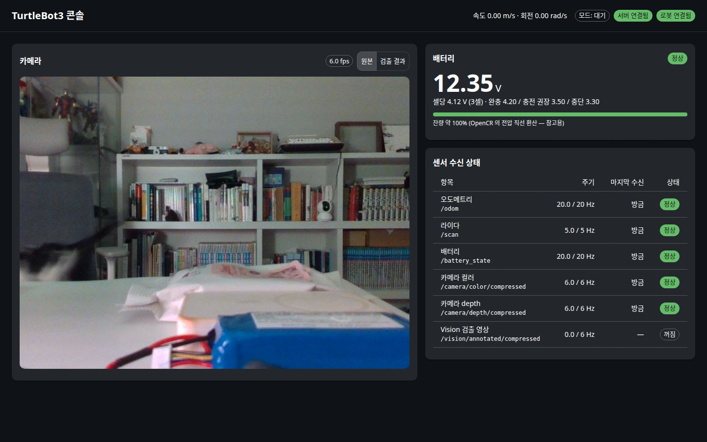

# my_web_api + web — 브라우저로 보는 로봇 콘솔

> 설계와 단계 계획은 [web_ui_design.md](./web_ui_design.md). 이 문서는 **구현된 것의 동작 원리**를 설명한다.
> 현재 범위: **P1 — 연결 상태 · 배터리 · 센서 수신 상태 · 카메라 영상** (2026-11-10).



## 1. 한 줄 요약

서버의 `web-api` 컨테이너가 **ROS 토픽을 받아 사람이 읽기 쉬운 API 로 바꿔** 주고, 같은 주소에서 React 화면을
제공한다. 브라우저는 `http://<서버 Tailscale IP>:8080` 만 열면 되고, **ROS 를 전혀 모른다.**

```
[Pi] bringup·카메라 ──Zenoh──▶ [서버] web-api 컨테이너 ───────────────▶ [브라우저]
                                  ├ rclpy 노드: /odom /scan /battery_state     GET  /            React 화면
                                  │            /camera/*/compressed /vision/*   GET  /api/status  상태 JSON
                                  └ FastAPI: 상태 계산, MJPEG, WebSocket        GET  /api/camera.mjpg 영상
                                                                                 WS   /ws          상태 push
```

## 2. 코드 구조

```
remote_pc/src/my_web_api/            ROS 2 패키지 (ament_python)
├── config/web_api.yaml              포트·배터리 판정 전압·토픽 이름 (단일 소스)
├── launch/web_api.launch.py         compose 의 web-api 가 실행
├── my_web_api/
│   ├── monitor.py                   ROS 없는 순수 로직: 토픽 주기 계산, 최신 프레임 보관, 배터리 판정
│   ├── ros_node.py                  rclpy 노드: 구독 → monitor 에 기록, snapshot() 으로 상태 조립
│   ├── app.py                       FastAPI 라우트: /api/status, MJPEG, WebSocket, 정적 파일
│   └── server.py                    진입점: ROS 스레드 + uvicorn, 종료 순서
└── test/test_monitor.py             monitor.py 단위 테스트 (ROS 불필요)

web/                                 React 프론트엔드 (npm 프로젝트, ROS 패키지 아님)
├── vite.config.ts                   개발 서버가 /api·/ws 를 web-api(:8080)로 프록시
└── src/
    ├── api/types.ts                 /api/status 형식 (ros_node.snapshot() 과 1:1)
    ├── api/useStatus.ts             WebSocket 연결·자동 재연결 훅
    ├── components/StatusBar.tsx     모드·서버 연결·로봇 연결·속도
    ├── components/CameraPanel.tsx   MJPEG , 원본/검출 결과 전환
    ├── components/BatteryCard.tsx   전압·셀 전압·판정
    └── components/TopicTable.tsx    토픽별 주기·마지막 수신·상태
```

## 3. 사용 기술과 선택 이유

| 기술 | 역할 | 왜 |
|---|---|---|
| **FastAPI** + uvicorn | HTTP·WebSocket 서버 | rclpy 와 같은 파이썬. 비동기·WebSocket 기본 지원. `/docs` 에 API 문서 자동 생성 |
| **rclpy** | 토픽 구독 | 이미 my_vision 이 쓰는 공식 클라이언트. P2 에서 Nav2 액션·TF2 를 그대로 쓴다 |
| **React 19 + TypeScript + Vite 8** | 화면 | 로봇 웹 UI 레퍼런스(rmf-web, Foxglove 패널)가 React. 타입으로 API 형식 불일치를 컴파일 때 잡는다 |
| **MUI 9** | 화면 부품 | 카드·표·칩·토글 같은 대시보드 부품이 다 있어 직접 CSS 를 거의 안 씀 |
| **MJPEG** | 카메라 영상 | 아래 4.3 |

설계 단계에서 고려했던 TanStack Query 는 P1 에 REST 호출이 없어(상태는 전부 WebSocket) 넣지 않았다. P2 에서
지도·목표 같은 REST 호출이 생길 때 도입한다.

## 4. 원리

### 4.1 두 세계를 잇는 스레드 구조

ROS(rclpy)는 콜백을 **자기 스레드**에서 부르고, FastAPI 는 **asyncio 이벤트 루프**에서 돈다. 둘을 한 프로세스에 둔다.

```
메인 스레드:  uvicorn (asyncio) ── 요청이 오면 node.snapshot() / FrameStore.get() 을 읽는다
백그라운드:   rclpy executor ──── 메시지가 오면 TopicMonitor.record() / FrameStore.put() 으로 쓴다
                                    ↑ 둘 사이의 공유 데이터는 전부 threading.Lock 으로 보호 (monitor.py)
```

콜백은 "받았다는 기록"과 "최신값 저장"만 하고 계산은 하지 않는다. 주기(Hz)·경과 시간·판정은 화면이 물어볼 때
(`snapshot()`, 0.5초마다) 계산한다 → 20Hz 토픽이 많아도 ROS 쪽 부담이 거의 없다.

### 4.2 토픽 주기 계산

최근 3초 동안 받은 메시지 시각들로 `(개수 − 1) / (마지막 − 처음)` 을 계산한다. 2초 넘게 안 오면 "수신 없음"
(Vision 처럼 선택 토픽은 "꺼짐"). 기대 주기의 70% 미만이면 화면에 "느림" 으로 표시 — 예: Pi 전원 저하로
카메라가 3fps 로 떨어지면 바로 보인다.

### 4.3 카메라 영상: MJPEG

로봇은 이미 영상을 **JPEG 로 압축**해서 보낸다(`/camera/color/compressed`). MJPEG(Motion JPEG)는 HTTP 응답 하나에
JPEG 를 경계 문자열로 이어 붙여 계속 보내는 방식이고, 브라우저 `` 가 이를 동영상처럼
갱신한다. 그래서 **서버도 브라우저도 디코딩·재인코딩을 하지 않는다** — 받은 JPEG 바이트를 그대로 흘린다.
WebRTC 는 지연·대역폭에 유리하지만 6fps·0.2MB/s 영상에는 복잡도만 늘어난다.

서버는 새 프레임이 있을 때만(버전 번호 비교) 보내고, 화면은 토픽 상태가 "정상"일 때만 `` 를 띄운다
(영상이 없을 땐 이유를 글로 표시).

### 4.4 QoS

`/scan`·카메라는 publisher 가 **best effort** 라 reliable 로 구독하면 아무것도 못 받는다(my_slam.md 의 QoS 설명).
best effort 구독은 reliable publisher(`/odom` 등)도 받을 수 있으므로 전부 센서 QoS(`qos_profile_sensor_data`)로 통일했다.

### 4.5 배터리: % 보다 셀 전압

`/battery_state.percentage` 는 Pi 가 아니라 **OpenCR 펌웨어가 계산한 값**이다. 실측 3점(12.00V→83.3%,
12.22V→95.5%, 12.35V→102.8%)이 **10.5V=0%, 12.3V=100% 직선**과 정확히 일치한다. 그래서 충전 중엔 100% 를 넘고,
LiPo 의 실제 방전 곡선(중간에 오래 머물다 끝에서 급락)과도 다르다. 화면은 이 값을 0~100 으로 잘라 **참고용**으로만
보여주고, 판정은 **셀당 전압**으로 한다: 3.5V(3S 10.5V) 미만 "충전 권장", 3.3V(9.9V) 미만 "즉시 중단"
(`config/web_api.yaml`).

### 4.6 종료 순서 (끝나지 않는 응답이 있을 때)

MJPEG·WebSocket 은 브라우저가 닫을 때까지 끝나지 않는 연결이라, 종료를 잘못 다루면 서버가 멈추거나 강제 종료된다.
`server.py` 는 신호를 **직접** 받아 이렇게 끝낸다.

1. SIGINT/SIGTERM → `stop` 이벤트 set (열린 MJPEG·WebSocket 루프가 스스로 끝남) + uvicorn 에 종료 요청
2. uvicorn 이 남은 연결을 최대 2초 기다린 뒤 닫고 `server.run()` 이 정상 반환
3. ROS executor 정지 → 노드 파괴 → `rclpy.shutdown()`

이렇게 된 과정(uvicorn 의 신호 재발생, 중복 SIGINT)은 [troubleshooting.md](./troubleshooting.md) 2026-11-10 항목.

## 5. 실행

### 평소 (서버 부팅 시 자동)

compose 의 `web-api` 서비스가 `restart: unless-stopped` 로 떠 있다. 브라우저에서:

```
http://100.95.193.1:8080        웹 콘솔 (맥·폰 모두 Tailscale 접속 상태에서)
http://100.95.193.1:8080/docs   API 문서 (FastAPI 자동 생성)
```

```bash
docker compose logs web-api -f       # 로그
docker compose restart web-api       # 설정(web_api.yaml)·백엔드 코드 변경 후
```

### 코드를 고쳤을 때

| 바꾼 것 | 할 일 |
|---|---|
| 백엔드 파이썬 (`my_web_api/*.py`) | `docker compose restart web-api` (symlink-install 이라 재빌드 불필요) |
| 새 파일·setup.py·launch | 컨테이너에서 `colcon build --symlink-install --packages-select my_web_api` → restart |
| 프론트엔드 (`web/src`) | 서버 호스트에서 `cd web && npm run build` → 브라우저 새로고침 (web-api 가 `web/dist` 를 그대로 제공) |
| 프론트엔드 개발 중 | `cd web && npm run dev` → `http://<서버>:5173` (저장하면 즉시 반영, API 는 :8080 으로 프록시) |

### 테스트

```bash
docker compose exec remote-pc bash -c 'cd /overlay_ws/src/my_web_api && python3 -m pytest -q test'   # 6 passed
cd web && npm run build && npm run lint                                                              # 타입·린트
```

## 6. 검증 기록 (2026-11-10, 로봇 실기)

- `/api/status`: odom 19.7Hz, scan 4.9Hz, battery 20Hz, color·depth 6.0Hz 정상, vision "꺼짐"(미실행). 배터리 12.22V·셀 4.07V "정상".
- MJPEG 3초: 19프레임(6fps 기대치 18), 프레임당 약 48KB — 로봇 JPEG 그대로.
- WebSocket: 0.5초 간격 status 수신.
- 종료: MJPEG 연결이 열린 상태에서 SIGINT → 0.4초 내 정상 종료, traceback 없음 (2회 반복).
- compose `web-api` 기동 후 Tailscale 주소(`100.95.193.1:8080`)로 화면·`/docs` 접속 200, 데스크톱·폰 폭(400px) 레이아웃 확인.

## 7. 다음 (P2)

지도 PNG·로봇 위치·라이다 점·전역/단기 경로·로컬 장애물 지도 오버레이, 클릭으로 Nav2 목표 지정
([web_ui_design.md](./web_ui_design.md) 8장). 카메라 회피 V1(깊이 층)과 함께.
