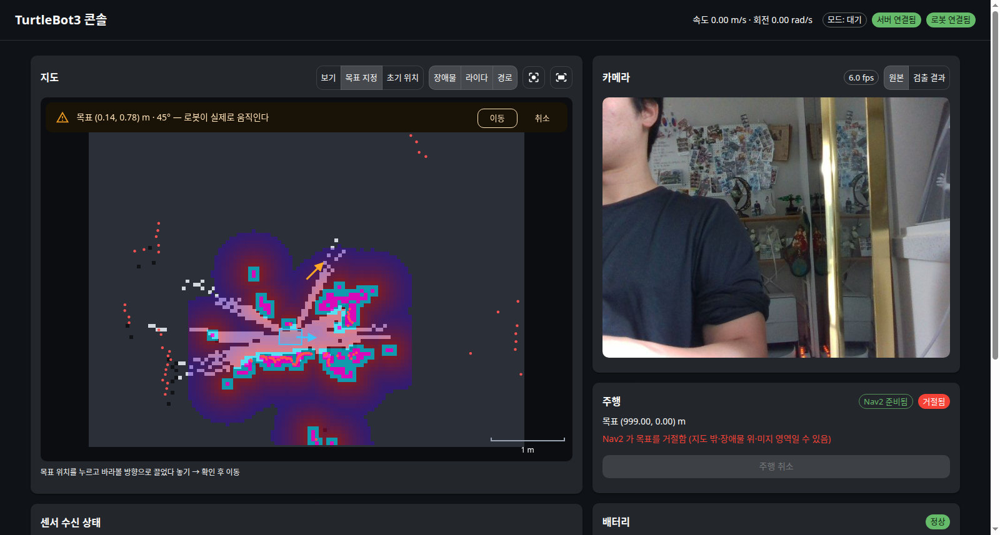

# my_web_api + web — 브라우저로 보는 로봇 콘솔

> 설계와 단계 계획은 [web_ui_design.md](./web_ui_design.md). 이 문서는 **구현된 것의 동작 원리**를 설명한다.
> 현재 범위: **P1 — 연결 상태 · 배터리 · 센서 수신 상태 · 카메라 영상** (2026-11-10),
> **P2 — 지도 위 로봇·라이다·로컬 장애물 지도·경로, 클릭으로 Nav2 목표·취소·AMCL 초기 위치** (2026-11-12).



(P1 화면: [web_ui_p1.png](./images/web_ui_p1.png))

## 1. 한 줄 요약

서버의 `web-api` 컨테이너가 **ROS 토픽을 받아 사람이 읽기 쉬운 API 로 바꿔** 주고, 같은 주소에서 React 화면을
제공한다. 브라우저는 `http://<서버 Tailscale IP>:8080` 만 열면 되고, **ROS 를 전혀 모른다.**

```
[Pi] bringup·카메라 ──Zenoh──▶ [서버] web-api 컨테이너 ───────────────▶ [브라우저]
                                  ├ rclpy 노드: /odom /scan /battery_state     GET  /               React 화면
                                  │   /camera/*/compressed /vision/*            GET  /api/status     상태 JSON
                                  │   /map /local_costmap/* /plan /local_plan   GET  /api/camera.mjpg 영상
                                  │   TF(map→로봇), Nav2 NavigateToPose 액션     GET  /api/map.png    지도
                                  └ FastAPI: 좌표 변환·PNG·MJPEG·WebSocket      POST /api/nav/goal   주행 목표
                                                                                 WS   /ws             실시간 push
```

## 2. 코드 구조

```
remote_pc/src/my_web_api/            ROS 2 패키지 (ament_python)
├── config/web_api.yaml              포트·배터리 판정 전압·토픽 이름 (단일 소스)
├── launch/web_api.launch.py         compose 의 web-api 가 실행
├── my_web_api/
│   ├── monitor.py                   ROS 없는 순수 로직: 토픽 주기 계산, 최신 프레임 보관, 배터리 판정
│   ├── geometry.py                  ROS 없는 2D 변환: 쿼터니언↔yaw, 점 변환, 라이다 극좌표→점, 솎기
│   ├── map_codec.py                 OccupancyGrid → RGBA PNG (지도 / costmap 색 규칙)
│   ├── nav.py                       Nav2 목표·취소·진행 상태, AMCL 초기 위치 (ROS 스레드 큐)
│   ├── ros_node.py                  rclpy 노드: 구독·TF → 지도 좌표로 정리, snapshot() 으로 상태 조립
│   ├── app.py                       FastAPI 라우트: 상태·영상·지도·주행 API, WebSocket, 정적 파일
│   └── server.py                    진입점: ROS 스레드 + uvicorn, 종료 순서
├── test/                            monitor·geometry·map_codec 단위 테스트 14개 (ROS 불필요)
└── tools/                           fake_nav.py(로봇 안 움직이는 가짜 Nav2) · nav_api_check.py(주행 API 점검)

web/                                 React 프론트엔드 (npm 프로젝트, ROS 패키지 아님)
├── vite.config.ts                   개발 서버가 /api·/ws 를 web-api(:8080)로 프록시
└── src/
    ├── api/types.ts                 서버 데이터 형식 (ros_node·app·nav 와 1:1)
    ├── api/useRobot.ts              WebSocket 하나로 모든 실시간 데이터 (reducer), 자동 재연결
    ├── api/nav.ts                   주행 요청 (TanStack Query mutation)
    ├── components/MapView.tsx       react-konva 지도: 레이어·확대/이동·따라가기·목표 찍기
    ├── components/MapPanel.tsx      도구(보기·목표·초기 위치)·레이어 토글·목표 확인 창
    ├── components/NavPanel.tsx      주행 상태·남은 거리·취소
    ├── components/StatusBar.tsx     모드·서버 연결·로봇 연결·속도
    ├── components/CameraPanel.tsx   MJPEG , 원본/검출 결과 전환
    ├── components/BatteryCard.tsx   전압·셀 전압·판정
    └── components/TopicTable.tsx    토픽별 주기·마지막 수신·상태
```

## 3. 사용 기술과 선택 이유

| 기술 | 역할 | 왜 |
|---|---|---|
| **FastAPI** + uvicorn | HTTP·WebSocket 서버 | rclpy 와 같은 파이썬. 비동기·WebSocket 기본 지원. `/docs` 에 API 문서 자동 생성 |
| **rclpy** | 토픽 구독 | 이미 my_vision 이 쓰는 공식 클라이언트. P2 에서 Nav2 액션·TF2 를 그대로 쓴다 |
| **React 19 + TypeScript + Vite 8** | 화면 | 로봇 웹 UI 레퍼런스(rmf-web, Foxglove 패널)가 React. 타입으로 API 형식 불일치를 컴파일 때 잡는다 |
| **MUI 9** | 화면 부품 | 카드·표·칩·토글 같은 대시보드 부품이 다 있어 직접 CSS 를 거의 안 씀 |
| **MJPEG** | 카메라 영상 | 아래 4.3 |
| **react-konva** (Konva 10) | 지도 그리기 | 캔버스 위에 레이어(이미지·점·선·다각형)를 React 컴포넌트로 쌓고, 확대·이동·포인터 좌표 변환을 기본 제공. ros2djs 계열은 roslibjs 전제·유지보수 불분명 |
| **TanStack Query** | 주행 요청 | 목표·취소 POST 의 진행 중·오류 상태를 선언적으로 (P1 엔 REST 호출이 없어 P2 에서 도입) |
| **OpenCV**(서버) | PNG 인코딩 | 컨테이너에 이미 있음. 격자 → PNG 를 버전당 한 번만 |

## 4. 원리

### 4.1 두 세계를 잇는 스레드 구조

ROS(rclpy)는 콜백을 **자기 스레드**에서 부르고, FastAPI 는 **asyncio 이벤트 루프**에서 돈다. 둘을 한 프로세스에 둔다.

```
메인 스레드:  uvicorn (asyncio) ── 요청이 오면 node.snapshot() / FrameStore.get() 을 읽는다
백그라운드:   rclpy executor ──── 메시지가 오면 TopicMonitor.record() / FrameStore.put() 으로 쓴다
                                    ↑ 둘 사이의 공유 데이터는 전부 threading.Lock 으로 보호 (monitor.py)
```

콜백은 "받았다는 기록"과 "최신값 저장"만 하고 계산은 하지 않는다. 주기(Hz)·경과 시간·판정은 화면이 물어볼 때
(`snapshot()`, 0.5초마다) 계산한다 → 20Hz 토픽이 많아도 ROS 쪽 부담이 거의 없다.

### 4.2 토픽 주기 계산

최근 3초 동안 받은 메시지 시각들로 `(개수 − 1) / (마지막 − 처음)` 을 계산한다. 2초 넘게 안 오면 "수신 없음"
(Vision 처럼 선택 토픽은 "꺼짐"). 기대 주기의 70% 미만이면 화면에 "느림" 으로 표시 — 예: Pi 전원 저하로
카메라가 3fps 로 떨어지면 바로 보인다.

### 4.3 카메라 영상: MJPEG

로봇은 이미 영상을 **JPEG 로 압축**해서 보낸다(`/camera/color/compressed`). MJPEG(Motion JPEG)는 HTTP 응답 하나에
JPEG 를 경계 문자열로 이어 붙여 계속 보내는 방식이고, 브라우저 `` 가 이를 동영상처럼
갱신한다. 그래서 **서버도 브라우저도 디코딩·재인코딩을 하지 않는다** — 받은 JPEG 바이트를 그대로 흘린다.
WebRTC 는 지연·대역폭에 유리하지만 6fps·0.2MB/s 영상에는 복잡도만 늘어난다.

서버는 새 프레임이 있을 때만(버전 번호 비교) 보내고, 화면은 토픽 상태가 "정상"일 때만 `` 를 띄운다
(영상이 없을 땐 이유를 글로 표시).

### 4.4 QoS

`/scan`·카메라는 publisher 가 **best effort** 라 reliable 로 구독하면 아무것도 못 받는다(my_slam.md 의 QoS 설명).
best effort 구독은 reliable publisher(`/odom` 등)도 받을 수 있으므로 전부 센서 QoS(`qos_profile_sensor_data`)로 통일했다.

### 4.5 배터리: % 보다 셀 전압

`/battery_state.percentage` 는 Pi 가 아니라 **OpenCR 펌웨어가 계산한 값**이다. 실측 3점(12.00V→83.3%,
12.22V→95.5%, 12.35V→102.8%)이 **10.5V=0%, 12.3V=100% 직선**과 정확히 일치한다. 그래서 충전 중엔 100% 를 넘고,
LiPo 의 실제 방전 곡선(중간에 오래 머물다 끝에서 급락)과도 다르다. 화면은 이 값을 0~100 으로 잘라 **참고용**으로만
보여주고, 판정은 **셀당 전압**으로 한다: 3.5V(3S 10.5V) 미만 "충전 권장", 3.3V(9.9V) 미만 "즉시 중단"
(`config/web_api.yaml`).

### 4.6 종료 순서 (끝나지 않는 응답이 있을 때)

MJPEG·WebSocket 은 브라우저가 닫을 때까지 끝나지 않는 연결이라, 종료를 잘못 다루면 서버가 멈추거나 강제 종료된다.
`server.py` 는 신호를 **직접** 받아 이렇게 끝낸다.

1. SIGINT/SIGTERM → `stop` 이벤트 set (열린 MJPEG·WebSocket 루프가 스스로 끝남) + uvicorn 에 종료 요청
2. uvicorn 이 남은 연결을 최대 2초 기다린 뒤 닫고 `server.run()` 이 정상 반환
3. ROS executor 정지 → 노드 파괴 → `rclpy.shutdown()`

이렇게 된 과정(uvicorn 의 신호 재발생, 중복 SIGINT)은 [troubleshooting.md](./troubleshooting.md) 2026-11-10 항목.

### 4.7 지도 화면의 좌표 — 서버가 전부 map 좌표로 바꿔서 보낸다

ROS 에서 데이터마다 좌표계가 다르다. 브라우저가 이걸 다루지 않도록 **서버가 TF 로 전부 지도(map) 좌표, 미터로
바꿔서** 보낸다 (`ros_node.py`, `geometry.py`).

| 데이터 | 원래 좌표계 | 서버에서 하는 일 |
|---|---|---|
| 로봇 위치 | `base_footprint` | TF `map → base_footprint` 조회 (WebSocket 이 0.1초마다) |
| 라이다 `/scan` | `base_scan` (극좌표: 각도·거리) | (각도, 거리) → (x, y) 로 바꾸고 360 빔을 180 개로 솎은 뒤 `map ← base_scan` 변환 |
| 로컬 장애물 지도 | `odom` (로봇을 따라다니는 3m 창) | 격자 원점(x, y, 회전)을 `map ← odom` 으로 변환해 메타에 실음. 이미지는 그대로 |
| 전역 경로 `/plan` | `map` | 300 점 이하로 솎기만 |
| 단기 궤적 `/local_plan` | `odom` | 솎고 `map ← odom` 변환 |
| 로봇 외곽 | `odom` (`/local_costmap/published_footprint`) | 변환. footprint 값 자체는 nav2_params.yaml 이 단일 소스 (웹에 복제하지 않음) |

**표시 좌표계 자동 전환.** SLAM·AMCL 이 꺼져 있으면 `map` 좌표계 자체가 없다. 이때는 `odom`(로봇이 켜진 위치 기준)으로
바꿔서 로봇과 라이다를 계속 실시간으로 보여주고, 지난 지도는 숨긴다 (화면에 "출발점(odom) 기준" 표시). 좌표계가 아예
없으면 라이다는 빈 목록을 보내 옛 점을 지운다. 처음 구현에선 `map` 이 없으면 라이다를 안 보내서 **화면에 SLAM 을 끈
시점의 점과 지도가 멈춘 채 남아 "라이다가 실시간이 아닌" 것처럼 보였다** (2026-11-12 사용자 발견 → 수정). 「초기 위치」
도구에선 AMCL 이 아직 위치를 모르므로 지도를 보여주고 odom 기준 레이어를 숨긴다.

TF 는 **메시지 시각이 아니라 최신 값**으로 조회한다. Pi→서버 브리지 지연 때문에 메시지 시각에 정확히 맞추면
"extrapolation" 오류가 잦고, 화면 표시에선 수십 ms 차이가 보이지 않는다. 변환식은 2D 회전 + 평행이동
(`p_map = R(yaw)·p + t`) 이고, 쿼터니언은 지면 로봇이라 yaw 만 쓴다.

### 4.8 격자 지도 → 이미지

`OccupancyGrid` 는 칸마다 값이 하나인 2차원 배열이다. 서버가 색을 입혀 PNG 로 만들고(`map_codec.py`), 브라우저는
지도 좌표의 원점에 깔기만 한다.

- 지도: -1 미지(어두운 회색) · 0 빈 공간(밝은 회색) · 100 장애물(검정).
- 로컬 장애물 지도: 자유 공간은 투명, 장애물 주변 비용(inflation)은 파랑→빨강, 로봇이 닿는 거리(inscribed)는
  하늘색, 장애물(lethal)은 자홍색 — RViz 의 costmap 색과 같게 해서 개발자가 둘을 오가도 헷갈리지 않게 했다.
- 격자의 0번 행은 **지도 아래쪽**인데 이미지의 0번 행은 위쪽이라, 서버에서 위아래를 뒤집어 보낸다.
- 지도는 slam_toolbox 가 5초마다 새로 보낸다. 서버는 받은 것마다 버전을 올리고, 브라우저는 `?v=버전` 주소로
  요청하므로 같은 버전은 캐시된다. PNG 인코딩도 버전당 한 번.

### 4.9 브라우저에서 그리기 (react-konva)

화면 좌표는 아래로 y 가 커지고, 지도 좌표는 위로 y 가 커진다. `MapView.tsx` 는 이렇게 처리한다.

```
Stage (화면):   위치 (x, y) + 배율 s [픽셀/미터]   ← 확대·이동은 이 세 값만 바꾼다
 └ world 그룹:  scaleY = -1  (y 를 뒤집어 '지도 좌표계'를 만든다)
     └ 모든 레이어를 지도 좌표(미터) 그대로 그린다: 지도 이미지, 장애물 지도, 라이다 점, 경로, 로봇
```

- 선 굵기·점 크기는 확대해도 같은 픽셀로 보이게 `strokeScaleEnabled={false}`, 점 반지름 = 픽셀 / s.
- 격자 이미지는 원점에 회전 그룹을 두고 그 안에 `scaleY=-1` 로 다시 뒤집어 깐다 (서버가 뒤집은 것을 되돌림).
- 포인터 위치는 world 그룹의 `getRelativePointerPosition()` 이 곧 지도 좌표다 → 목표 좌표 계산 코드가 없다.
- "로봇 따라가기" 는 상태로 저장하지 않고 그릴 때마다 로봇 위치로 Stage 위치를 계산한다.

### 4.10 목표 지정과 안전 장치

- **누른 곳 = 목표 위치, 끌어서 놓은 방향 = 도착 후 바라볼 방향** (RViz "2D Goal Pose" 와 같은 조작).
  끌지 않고 탭만 하면 로봇에서 그 점을 바라보는 방향.
- 찍은 즉시 보내지 않고 **확인 창 → 「이동」** 을 한 번 더 눌러야 전송된다. 폰에서 지도를 만지다 실수로 로봇이
  출발하는 것을 막는다. 같은 방식으로 「초기 위치」(AMCL `/initialpose`)도 지정한다.
- 「목표 지정」은 Nav2 액션 서버가 있을 때만 켜지고, 주행 중엔 큰 「주행 취소」 버튼이 활성화된다.

### 4.11 Nav2 액션을 웹에서 부르는 법 (스레드 규칙)

목표 전송은 Nav2 의 `NavigateToPose` **액션**이다 (요청 → 수락/거절 → 진행 feedback → 결과). rclpy 객체를
FastAPI 스레드와 ROS 스레드가 동시에 만지지 않도록 `nav.py` 는 이렇게 한다.

```
POST /api/nav/goal ─▶ 큐에 (요청, Future) 넣기 ─▶ ROS 타이머(20Hz)가 꺼내 send_goal_async
                         ◀─ Future 결과(수락/거절/Nav2 없음) ◀─ 수락 응답 콜백
feedback·결과 콜백 ─▶ 상태(state·남은 거리·경과·복구 횟수) 갱신 + 버전 ↑ ─▶ WebSocket 'nav' 로 push
```

실패는 HTTP 코드로 구분한다: Nav2 미실행 503, 거절·진행 중 목표 없음 409, 응답 없음 504. 목표를 연달아 보내면
이전 목표의 늦은 콜백이 새 상태를 덮어쓰지 않도록 목표 번호(seq)를 비교한다.

## 5. 실행

### 평소 (서버 부팅 시 자동)

compose 의 `web-api` 서비스가 `restart: unless-stopped` 로 떠 있다. 브라우저에서:

```
http://100.95.193.1:8080        웹 콘솔 (맥·폰 모두 Tailscale 접속 상태에서)
http://100.95.193.1:8080/docs   API 문서 (FastAPI 자동 생성)
```

```bash
docker compose logs web-api -f       # 로그
docker compose restart web-api       # 설정(web_api.yaml)·백엔드 코드 변경 후
```

### 코드를 고쳤을 때

| 바꾼 것 | 할 일 |
|---|---|
| 백엔드 파이썬 (`my_web_api/*.py`) | `docker compose restart web-api` (symlink-install 이라 재빌드 불필요) |
| 새 파일·setup.py·launch | 컨테이너에서 `colcon build --symlink-install --packages-select my_web_api` → restart |
| 프론트엔드 (`web/src`) | 서버 호스트에서 `cd web && npm run build` → 브라우저 새로고침 (web-api 가 `web/dist` 를 그대로 제공) |
| 프론트엔드 개발 중 | `cd web && npm run dev` → `http://<서버>:5173` (저장하면 즉시 반영, API 는 :8080 으로 프록시) |

### 테스트

```bash
docker compose exec remote-pc bash -c 'cd /overlay_ws/src/my_web_api && python3 -m pytest -q test'   # 14 passed
cd web && npm run build && npm run lint                                                              # 타입·린트
```

**로봇을 움직이지 않고 주행 흐름 시험** — 진짜 Nav2 가 꺼진 상태에서 가짜 액션 서버를 띄운다:

```bash
docker compose exec remote-pc bash
source /opt/ros/humble/setup.bash
python3 /overlay_ws/src/my_web_api/tools/fake_nav.py &          # navigate_to_pose 흉내 (cmd_vel 없음)
python3 /overlay_ws/src/my_web_api/tools/nav_api_check.py       # 목표→도착 / 목표→취소 / 거절 / 초기 위치
```

## 6. 검증 기록

**P1 (2026-11-10, 로봇 실기)**

- `/api/status`: odom 19.7Hz, scan 4.9Hz, battery 20Hz, color·depth 6.0Hz 정상, vision "꺼짐"(미실행). 배터리 12.22V·셀 4.07V "정상".
- MJPEG 3초: 19프레임(6fps 기대치 18), 프레임당 약 48KB — 로봇 JPEG 그대로.
- WebSocket: 0.5초 간격 status 수신.
- 종료: MJPEG 연결이 열린 상태에서 SIGINT → 0.4초 내 정상 종료, traceback 없음 (2회 반복).
- compose `web-api` 기동 후 Tailscale 주소(`100.95.193.1:8080`)로 화면·`/docs` 접속 200, 데스크톱·폰 폭(400px) 레이아웃 확인.

**P2 (2026-11-12, 로봇 실기 + 시험용 가짜 Nav2)**
- 실제 SLAM+Nav2 (`system.launch.py rviz:=false vision:=false`): 지도 117×90칸(5cm), 로컬 장애물 지도 60×60칸
  (원점이 map 기준으로 변환됨), 3초 동안 WebSocket 으로 위치 23·라이다 16(≈5Hz)·장애물 지도 6(2Hz)·외곽 16 메시지.
- 경로: 로봇을 움직이지 않는 `compute_path_to_pose`(계산만) 요청 → 전역 경로 22점이 지도에 표시.
- 로봇 외곽: 실측 footprint + Nav2 기본 여유 1cm 를 로봇 방향(3.7°)만큼 돌린 값과 일치 (0.065, 0.104).
- 주행 API (가짜 Nav2): 목표→수락→feedback→도착, 목표→취소→canceled, 거절 409, 진행 중 목표 없음 409,
  Nav2 미실행 503, `/initialpose` 내용(map 프레임, yaw 0.3 → z 0.149) 확인.
- 화면 (헤드리스 크롬 원격 조작): 「목표 지정」→ 화면 오른쪽 위로 끌기 → 확인 창 "목표 (0.14, 0.78) m · 45°" →
  「취소」→ 목표 미전송(nav 버전 불변). 휠 확대·로봇 따라가기 확인.
- 지도 없는 대기 상태(SLAM·Nav2 꺼짐): odom 기준으로 라이다 4초 21메시지(0.2초 간격, 끊김 없음), 점 좌표 매 메시지 갱신.
  라이다 점은 컴포넌트 하나(Konva Shape)로 그려 5Hz 갱신 부담을 줄였다.
- ⏳ **실제 주행(목표 클릭 → 로봇 이동 → 장애물 회피가 화면에 보임)은 로봇을 바닥에 두고 사용자 입회 하 검증 예정.**
  (이번엔 로봇 위치를 몰라 움직이는 시험을 하지 않았다.)

## 7. 다음

- P2 실주행 검증 (위 ⏳), 그때 카메라 회피 V1(깊이 층)도 함께 ([vision_avoidance_design.md](./vision_avoidance_design.md)).
- P3 모드 관리: 웹 버튼으로 지도 만들기 / 저장 / 저장 지도로 주행 전환 ([web_ui_design.md](./web_ui_design.md) 4장).
